# ТБК Отчёт
## Руководство пользователя для Android · версия 2.x

## Содержание
- Возможности программы
1. Как устроена программа на смартфоне
2. Вы приехали на трассу и принимаете смену
3. Заполните шапку отчёта
4. Заполнение списка с оборудованием
5. Уточните проблемные вопросы
6. ЗИП: справочник комплектующих и наличие
7. Подготовьте нумерацию: новый или уже начатый коллектор
8. Заполняйте отчёт по ходу работы
9. Сохраните и отправьте отчёт
10. Закончили старый коллектор и начинаете новый
11. История: найти, исправить или повторно выгрузить отчёт
12. Настройки
13. Резервные копии и передача данных другому технику
14. Обновление программы

---

## Возможности программы
Программа предназначена для подготовки ежедневных отчётов о сварочно-монтажных работах. Она объединяет сведения о двух сменах, считает сваренные стыки и ремонты, сохраняет историю и экспортирует отчёты в Excel и PDF.

Это руководство для смартфона с Android. Для компьютера есть отдельное «Руководство пользователя для Windows». Программы на смартфоне и на компьютере умеют одно и то же и обмениваются данными через резервную копию.

Возможности программы:
- Ведение первой и второй смены: время работы, номера и количество стыков, ремонты, комментарии.
- Расчёт количества по номерам стыков или определение номеров по введённому количеству.
- Учёт нарастающих итогов за месяц и продолжение нумерации по ГК.
- Заполнение шапки отчёта, списка техников и их подписей, нарисованных пальцем.
- Ведение оборудования и проблемных вопросов.
- Учёт ЗИП: справочник комплектующих, количество в наличии, расход за каждую смену и отчёт о расходе ЗИП за месяц в PDF.
- Просмотр, исправление и удаление сохранённых отчётов, в том числе смена номера ГК у уже сохранённого отчёта.
- Ручной и автоматический экспорт в Excel и PDF.
- Восстановление незавершённой работы и перенос данных через резервную копию.

## 1. Как устроена программа на смартфоне
Все скриншоты в руководстве пронумерованы. Ссылка вида «рисунок 2, цифра 3» означает: на рисунке 2 найдите красную рамку с цифрой 3.

Название открытого раздела крупно написано на синей полосе вверху экрана — всегда сверяйтесь с ним, чтобы не заполнить не ту смену или не тот раздел. Под полосой находится «Дата отчёта» (рисунок 1, цифра 4), ниже — прокручиваемая форма раздела.

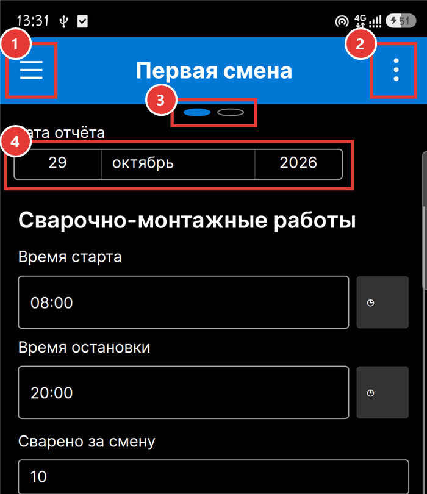

### Меню разделов
Нажмите кнопку с тремя горизонтальными полосками в левом верхнем углу (рисунок 1, цифра 1). Откроется боковое меню (рисунок 2):
- «Первая смена» и «Вторая смена» (рисунок 2, цифра 1).
- «Данные отчёта» (рисунок 2, цифры 2 и 3): «Проблемы», «Оборудование», «Шапка отчёта» и «Приём начатого коллектора».
- «ЗИП» (рисунок 2, цифра 4): «В наличии», «Комплектующие» и «Отчёт за месяц».
- «История отчётов» (рисунок 2, цифра 5).

Группы «Данные отчёта» и «ЗИП» при запуске уже раскрыты. Нажатие на название группы сворачивает или раскрывает её.

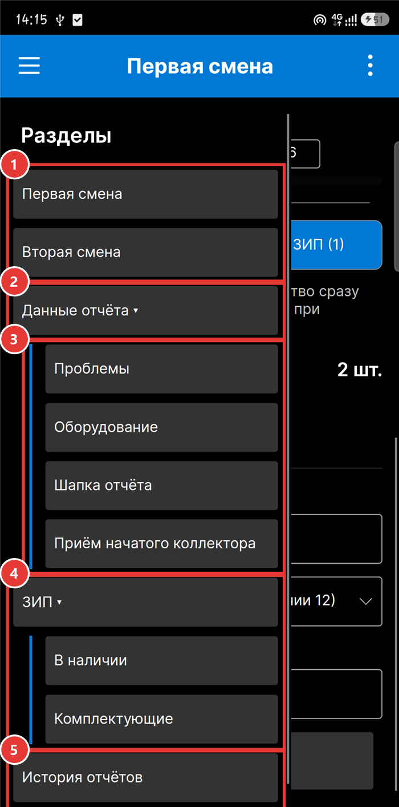

### Перелистывание разделов
Разделы одной группы листаются смахиванием — проведите пальцем по экрану влево или вправо. Так можно перейти от первой смены ко второй или от «Проблем» к «Оборудованию». Полоска точек над датой (рисунок 1, цифра 3) показывает, сколько разделов в открытой группе и какой из них сейчас на экране.

Смахиванием нельзя перейти из одной группы в другую: для этого откройте меню разделов.

### Меню действий
Нажмите три точки в правом верхнем углу (рисунок 3, цифра 1). Здесь расположены «Сохранить отчёт» (рисунок 3, цифра 2), «Экспортировать Excel» и «Экспортировать PDF» (рисунок 3, цифра 3), «Новый отчёт» (рисунок 3, цифра 4) и «Настройки» (рисунок 3, цифра 5).

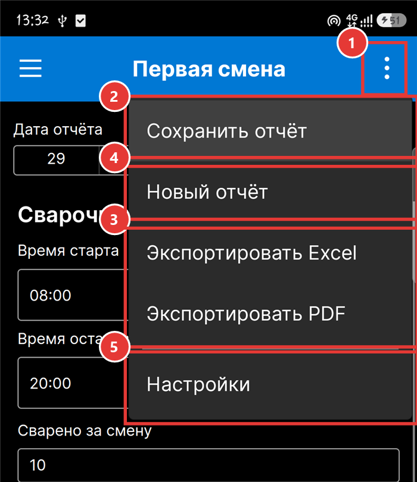

### Кнопка «Назад»
Можно пользоваться как кнопками возврата на экране, так и системной кнопкой или жестом «Назад». Если открыта форма добавления или редактор подписи, «Назад» сначала закрывает их без сохранения.

---

## 2. Вы приехали на трассу и принимаете смену
Перед первым отчётом уточните у техника, которого меняете, состояние работ. Эти сведения понадобятся при заполнении программы:
- На каком объекте и комплексе ведутся работы, какая труба используется и какой номер у текущего ГК.
- Кто работает техником в каждой смене.
- Какое оборудование есть на участке, сколько единиц находится в работе и сколько в резерве, какие у него номера.
- Какой ЗИП есть в наличии и сколько каждой позиции.
- Какие проблемы остаются нерешёнными и что необходимо отразить в отчёте.
- Начинается ли сварка коллектора с нуля или часть стыков уже сварена. Если работы идут, узнайте последний номер стыка, количество сваренных стыков и ремонтов за текущий месяц.

Запустите программу и проверьте «Дату отчёта» (рисунок 1, цифра 4). Затем в меню разделов откройте группу «Данные отчёта». Сначала заполните шапку, оборудование и проблемы, затем ЗИП в наличии, а после этого подготовьте данные для нумерации стыков.

Если коллега уже ведёт отчёты в программе, проще перенести его данные через резервную копию ([раздел 13](#13-резервные-копии-и-передача-данных-другому-технику)) и только проверить их.

## 3. Заполните шапку отчёта
Откройте меню разделов → «Шапка отчёта». Поля расположены друг под другом: прокручивайте экран вниз, чтобы заполнить всё. Внесите сведения, полученные при приёме смены (рисунок 4, цифра 2):
- «Заказчик» — наименование заказчика.
- «Проект» — название проекта.
- «Участок» — участок, на котором выполняются работы.
- «Комплекс» — обозначение вашего комплекса.
- «Труба» — параметры используемой трубы.
- «№ Газового коллектора» (рисунок 4, цифра 3) — номер коллектора, на котором вы работаете. Без него отчёт не сохранится. Можно указать любое целое число, в том числе 0 и отрицательное.

Номер ГК особенно важен: по нему программа распределяет отчёты по коллекторам. Проверьте номер перед началом заполнения смен.

Шапка сохраняется сама, когда вы переходите из поля в другое место или в другой раздел. Отдельной кнопки сохранения нет.

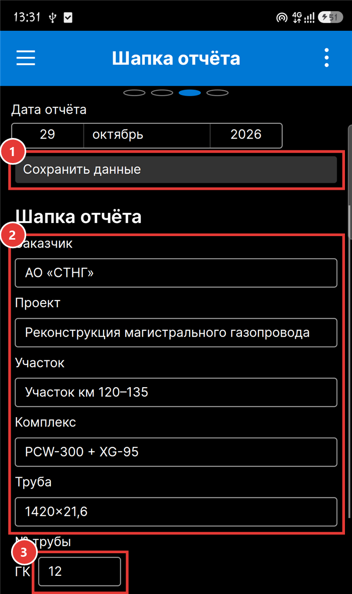

### Укажите техников и добавьте подписи
Ниже, в блоках «Техники первой смены» и «Техники второй смены», заполните фамилии и инициалы. Для каждой смены предусмотрено до двух техников.

После заполнения поля «Техник 1» над ним появляется кнопка «Добавить подпись». Нажмите её: поверх формы откроется редактор. Нарисуйте подпись пальцем в белом поле (рисунок 5, цифра 1).

«Очистить» (рисунок 5, цифра 2) позволяет нарисовать подпись заново, «Сохранить» (рисунок 5, цифра 3) принимает результат, а «Отмена» (рисунок 5, цифра 4) или системное «Назад» возвращает прежнюю подпись. Когда подпись уже есть, кнопка называется «Редактировать подпись». Подпись будет включена в Excel и PDF. Если удалить имя первого техника, его подпись тоже удалится.

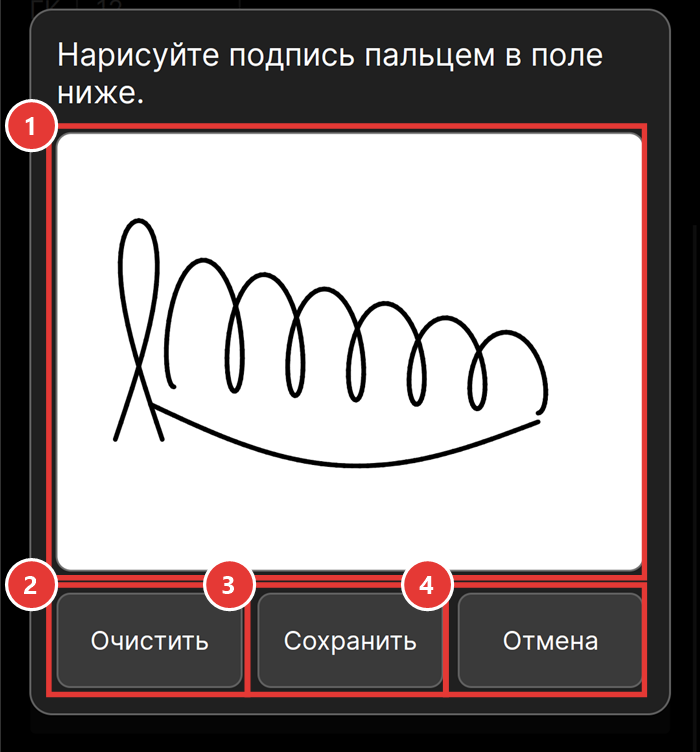

## 4. Заполнение списка с оборудованием
Откройте меню разделов → «Оборудование». Сверьте список с техником, которого меняете, и внесите фактическое количество оборудования.

Обозначения в программе и отчёте:
- «Рб» — в работе: сколько единиц оборудования задействовано в работе.
- «Рз» — в резерве: сколько единиц оборудования находится в резерве.

Например, если два аппарата используются, а один находится в резерве, укажите для этого оборудования «Рб: 2» и «Рз: 1». Если резерва нет, укажите 0.

Для каждой позиции заполните «Название оборудования», «В работе (Рб)» и «В резерве (Рз)» и нажмите «Добавить оборудование». Кнопками «Изменить» и «Удалить» у карточки можно исправить сведения. Количества вводятся целыми неотрицательными числами.

### Номера и производитель оборудования
Под количествами есть ещё два поля. Заполнять их не обязательно, но они нужны для отчёта о расходе ЗИП за месяц ([раздел 6](#6-зип-справочник-комплектующих-и-наличие)): по ним программа пишет, куда установлен ЗИП.
- «Номера» — впишите номера оборудования через запятую, например «10033, 10032».
- «Производитель» — нажмите на поле и выберите производителя оборудования. В списке те же производители, что и в справочнике комплектующих. Пункт «Не указан» убирает производителя.

Номера и производитель показаны в карточке оборудования под названием. В ежедневный отчёт Excel и PDF они не попадают.

Оборудование сохраняется само после нажатия «Добавить оборудование», «Сохранить изменения» или «Удалить».

## 5. Уточните проблемные вопросы
Откройте меню разделов → «Проблемы». Уточните у сменяемого техника, какие вопросы ещё не решены: например, неисправности оборудования, нехватка расходных материалов или ожидаемые поставки. Внесите актуальные проблемы отдельными пунктами: напишите текст в поле «Опишите проблему» и нажмите «Добавить проблему».

В этом разделе время не указывается. События конкретной смены с привязкой ко времени добавляются позднее в комментарии смены. Проблемы можно изменять и удалять кнопками «Изменить» и «Удалить»; программа сама обновляет их нумерацию.

Проблемы сохраняются сами после нажатия «Добавить проблему», «Сохранить изменения» или «Удалить». Шапка, оборудование и проблемы будут доступны при следующих запусках. В дальнейшем обновляйте их при изменении состава техников, оборудования или текущих проблем.

---

## 6. ЗИП: справочник комплектующих и наличие
ЗИП — запасные части и расходники для оборудования: наконечники, сопла, диффузоры и так далее. Программа ведёт два списка, записывает, сколько ЗИП израсходовано в каждой смене, и по этим записям составляет отчёт о расходе ЗИП за месяц. В ежедневный отчёт Excel и PDF расход ЗИП не попадает.

В меню разделов в группе «ЗИП» три раздела:
- «В наличии» — какие детали из справочника есть у вас и сколько штук.
- «Комплектующие» — справочник: все детали, которые вообще бывают, с наименованием, артикулом и производителем. Количества здесь нет.
- «Отчёт за месяц» — PDF с расходом ЗИП за выбранный месяц.

Между разделами группы можно перелистывать смахиванием.

Разделы «В наличии» и «Комплектующие» устроены одинаково: сверху поле поиска (рисунок 6, цифра 1), рядом кнопка «+ Добавить» (рисунок 6, цифра 2), ниже детали карточками: наименование, под ним артикул, справа количество (рисунок 6, цифра 3). Поиск находит деталь по части наименования, артикула или производителя; заглавные буквы и пробелы значения не имеют. Например, «тт552» найдёт «ТТ 552-2101». Текст карточки можно выделить долгим нажатием и скопировать.

Форма добавления открывается над списком. Системная кнопка или жест «Назад» закрывает её без сохранения.

### Справочник комплектующих
Справочник уже заполнен деталями комплекса «Альфа» производства «Технотрон» и частью деталей «Xionggu Electrical». Проверьте его и при необходимости дополните.

1. Откройте меню разделов → «Комплектующие».
2. Нажмите «+ Добавить».
3. Заполните «Наименование», «Артикул (каталожный номер)» и «Производитель». Обязательно только наименование. При вводе производителя программа подсказывает уже известных производителей по первым буквам — выберите нужного из списка.
4. Нажмите «Добавить комплектующую». «Отмена» закрывает форму без сохранения.

Кнопками «Изменить» и «Удалить» у карточки можно исправить или убрать деталь. Деталь, которая есть в разделе «В наличии», удалить нельзя: сначала уберите её оттуда.

### ЗИП в наличии
Список «В наличии» заполняется один раз, при приёме смены: пересчитайте ЗИП вместе с техником, которого меняете. В поле «Остатки на дату» (рисунок 6, цифра 5) укажите день, когда пересчитали.

Количество в наличии уменьшается само, только если в настройках включён «Учёт ЗИП» ([раздел 12](#12-настройки)). Тогда программа вычитает из пересчитанного количества расход ЗИП из всех сохранённых отчётов, начиная с даты «Остатки на дату». Пока учёт выключен, расход ЗИП только записывается в отчёты, а количество в наличии не меняется. Над списком написано, включён ли учёт.

1. Откройте меню разделов → «В наличии».
2. Нажмите «+ Добавить» (рисунок 6, цифра 2) — над списком появится форма «Добавление в наличие».
3. В поле «Найти в справочнике» начните вводить название или артикул и выберите деталь в списке под ним. Если найдена одна деталь, она выбирается сама. Детали, которые уже есть в наличии, показаны зелёным: если выбрать такую, введите, сколько штук лежит сейчас.
4. Введите количество и нажмите «Добавить в наличие».

Если пришла новая партия ЗИП или вы нашли ошибку, нажмите «Изменить» (рисунок 6, цифра 4) и введите, сколько штук лежит сейчас. «Удалить» убирает позицию из наличия; в справочнике она остаётся.

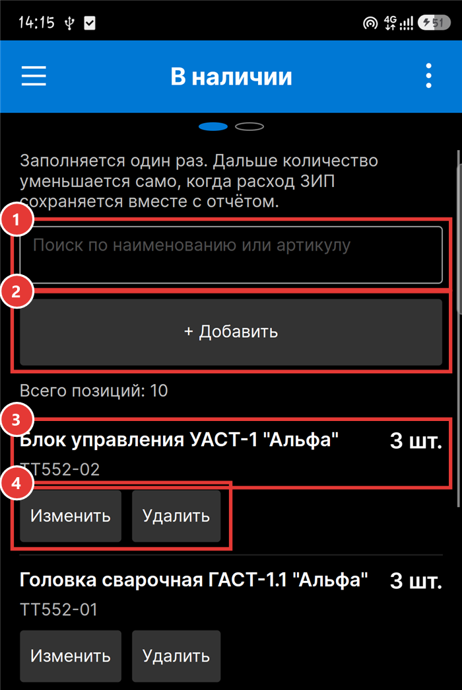

### Отчёт о расходе ЗИП за месяц
В конце месяца программа может сама составить отчёт о том, какой ЗИП списан за месяц. В него попадает расход из всех сохранённых отчётов месяца: обеих смен и всех ГК.

1. Откройте меню разделов → «Отчёт за месяц».
2. Нажмите на список «Месяц» и выберите месяц. В списке только месяцы, за которые есть сохранённые отчёты. Под ним появится, сколько штук ЗИП списано за этот месяц.
3. Нажмите «Создать отчёт». PDF с именем вида «Расход-ЗИП-11-2026.pdf» сохранится в папку экспорта ([раздел 12](#12-настройки)).

Если за месяц ничего не списано, программа сообщит об этом, а кнопка «Создать отчёт» будет недоступна. Если такой отчёт уже есть в папке, нажмите «Заменить» или «Отмена».

Чтобы в отчёте было заполнено, куда установлен ЗИП, укажите у оборудования номера и производителя ([раздел 4](#4-заполнение-списка-с-оборудованием)).

---

## 7. Подготовьте нумерацию: новый или уже начатый коллектор
Перед первым отчётом определите, с какого состояния вы начинаете работу в программе.

### Коллектор начинают варить с нуля
Укажите его номер ГК в шапке (рисунок 4, цифра 3). Программа начнёт нумерацию с первого стыка. Начальные данные заполнять не нужно — можно переходить к заполнению смен.

Первый номер подставляется после ввода времени старта смены: программа покажет его в поле «Первый стык №». Если в первой смене сварки не было, работу можно начать со второй.

### Коллектор уже начали варить
Если предыдущие работы ещё не внесены в историю программы, обязательно заполните начальные данные до первого отчёта. Иначе программа не сможет правильно продолжить нумерацию и учесть ранее выполненные работы в месячном итоге.

Уточните значения у техника, которого меняете, и сверьте их с предыдущим отчётом. Затем:
1. Проверьте месяц в дате отчёта и номер ГК в шапке.
2. Откройте меню разделов → «Приём начатого коллектора». Над полями написано, для какого месяца и ГК сохраняются данные.
3. В поле «Последний номер стыка» внесите номер последнего уже сваренного стыка этого коллектора.
4. В поле «Сварено стыков за месяц» внесите количество, уже сваренное в текущем месяце до начала ваших отчётов.
5. В поле «Ремонтов за месяц» внесите накопленное количество ремонтов за текущий месяц. Если ремонтов не было, укажите 0.
6. Нажмите «Сохранить начальные данные».

Например, последний сваренный стык — 274, за текущий месяц сварен 21 стык и выполнено 3 ремонта. Введите соответственно 274, 21 и 3. Следующим будет стык 275, а месячные количества продолжатся от 21 стыка и 3 ремонтов.

Последний номер стыка и количество за месяц — разные значения. Если коллектор начали в прошлом месяце, в месячное количество не нужно включать все стыки с начала его сварки.

Если предыдущие отчёты уже есть в истории программы, повторно включать эти работы в начальные данные не нужно: они будут учтены дважды. При приёме готовой истории проверьте её полноту и уже внесённые начальные данные.

### Если в начальных данных допущена ошибка
Чтобы заменить сохранённые значения, очистите все три поля и нажмите «Сохранить начальные данные». После этого внесите правильные значения и сохраните их снова. Перед изменением проверьте выбранные месяц и ГК.

---

## 8. Заполняйте отчёт по ходу работы
Откройте меню разделов → «Первая смена» или «Вторая смена» — ту, за которую вносите сведения. Проверьте название на синей полосе и дату: именно за неё будет сохранён отчёт.

### Начало и окончание сварки
Укажите «Время старта». Программа предложит первый номер стыка с учётом выбранного ГК, начальных данных и предыдущих отчётов. В конце работ укажите «Время остановки» и последний сваренный стык.

Время можно ввести с экранной клавиатуры в виде ЧЧ:ММ, например 08:00, или выбрать: нажмите кнопку с часами справа от поля, прокрутите часы и минуты и нажмите галочку. Так же выбирается время в комментариях смены.

В обычном режиме вы вводите «Первый стык №» и «Последний стык №», а программа считает количество включительно. Например, стыки с 275 по 284 — это 10 стыков. Второй смене программа предложит продолжить нумерацию со стыка 285.

Можно работать и по количеству стыков: вы вводите число в поле «Сварено за смену», а программа крупно показывает первый и последний номера под ним. Переключение режима описано в [разделе 12 «Настройки»](#12-настройки).

В поле «Ремонтов за смену» укажите количество ремонтов. Если их не было, введите 0.

Под полями смены находится переключатель «Комментарии | Расход ЗИП» (рисунок 7, цифра 1): нажмите нужную половину, чтобы увидеть комментарии или расход. В скобках показано, сколько строк расхода уже добавлено.

### Записывайте события смены
Нажмите «Комментарии» на переключателе. В блоке «Новый комментарий» укажите время в поле «Время / начало» и текст события в поле «Опишите событие». Если событие длилось продолжительное время, включите «Диапазон времени» и заполните ещё «Окончание». Например: «10:00–11:30 — ожидание трубы». Затем нажмите «Добавить комментарий».

Программа расставляет записи по возрастанию времени начала события. Комментарии можно изменять и удалять кнопками «Изменить» и «Удалить». При вводе времени старта и остановки автоматически появляются записи «Старт СМР» и «Стоп СМР». При изменении времени эти записи обновляются.

### Записывайте расход ЗИП
Если в смене израсходован ЗИП — например, вы выдали два наконечника для сварочного аппарата, — отметьте это в отчёте:
1. Нажмите «Расход ЗИП» на переключателе (рисунок 7, цифра 1).
2. В поле поиска (рисунок 7, цифра 2) начните вводить название или артикул детали.
3. Выберите деталь в списке (рисунок 7, цифра 3).
4. Введите количество (рисунок 7, цифра 4) и нажмите «Добавить в расход» (рисунок 7, цифра 5).

Если одну и ту же деталь добавить дважды, количества сложатся в одной строке. Ошибочную строку можно исправить или убрать кнопками «Изменить» и «Удалить». До сохранения отчёта расход хранится в черновике вместе с остальными полями смены.

Если в разделе «В наличии» ничего нет, программа напишет об этом: сначала заполните «В наличии» ([раздел 6](#6-зип-справочник-комплектующих-и-наличие)).

Что происходит дальше, зависит от «Учёта ЗИП» в настройках:
- Учёт выключен. В списке детали из «В наличии», но остаток рядом не показывается и количество не проверяется. Расход сохраняется вместе с отчётом, а количество в наличии не меняется.
- Учёт включён. Рядом с каждой деталью показано, сколько её ещё можно списать. Списать больше программа не даст: она сразу сообщит, сколько штук можно. Обе смены отчёта берут ЗИП из одного наличия. После сохранения расход вычитается из наличия; если позже исправить сохранённый отчёт, наличие пересчитается, а если удалить отчёт из истории, его ЗИП вернётся в наличие. Отчёты с датой раньше «Остатков на дату» не проверяются и из наличия не вычитаются.

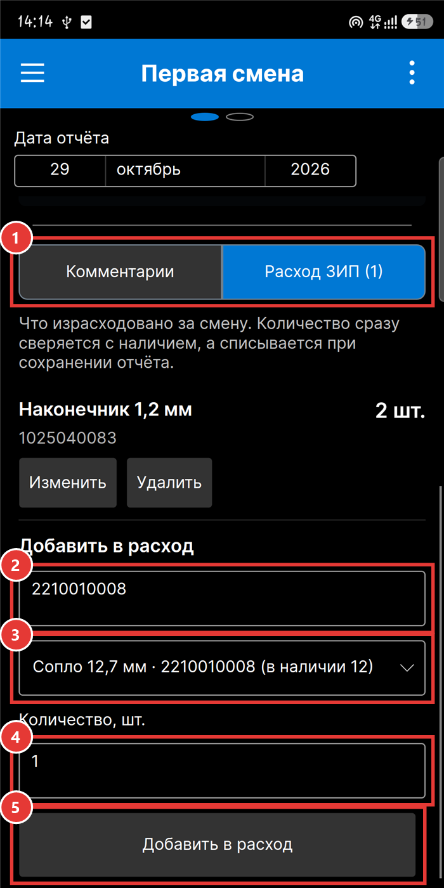

### Если сварки не было
Добавьте комментарий со временем и причиной, например: «08:00–19:00 — сломана головная АПС». Не вводите вымышленные номера стыков или время старта и окончания сварки.

Отчёт без сварки можно сохранить и экспортировать, если добавлен хотя бы один комментарий со временем. В такой смене оставьте пустыми время старта и остановки, стыки и ремонты. Если время старта указано, заполните все поля смены. Программа подсветит красным поля, которые нужно исправить.

В истории такой отчёт будет отмечен жёлтой пометкой «Простой» ([раздел 11](#11-история-найти-исправить-или-повторно-выгрузить-отчёт)).

### Если пришлось закрыть программу
Незавершённые поля смен, комментарии и расход ЗИП автоматически сохраняются в черновик и восстанавливаются при следующем запуске. Шапка, оборудование и проблемы сохраняются сами, отдельной кнопки для них нет.

---

## 9. Сохраните и отправьте отчёт
После заполнения смен проверьте дату, номер ГК, номера стыков, ремонты, комментарии и расход ЗИП. При необходимости обновите оборудование и проблемные вопросы.

Нажмите три точки справа вверху и выберите «Сохранить отчёт» (рисунок 3, цифра 2). Это добавит отчёт в историю вместе с его шапкой, подписями, оборудованием, проблемами и расходом ЗИП; при включённом учёте ЗИП расход вычтется из наличия. Если в форме расхода ЗИП осталась недобавленная строка, программа попросит сначала добавить её или очистить поля.

Затем в том же меню выберите «Экспортировать Excel» или «Экспортировать PDF» (рисунок 3, цифра 3). Файл сохранится в папку экспорта ([раздел 12](#12-настройки)); оттуда его можно отправить коллегам через мессенджер или почту. Если такой файл уже есть, программа спросит «Такой файл уже есть. Заменить?» — нажмите «Заменить» или «Отмена».

«Сохранить отчёт» фиксирует ежедневный отчёт в истории, а экспорт создаёт файл для отправки. Сам по себе экспорт не добавляет отчёт в историю.

За одну дату сохраняется один отчёт для каждого ГК. Повторно сохранить его нельзя: чтобы исправить сохранённый отчёт, откройте его в истории ([раздел 11](#11-история-найти-исправить-или-повторно-выгрузить-отчёт)).

### Как читать месячные итоги
Месячные показатели учитывают начальные данные и отчёты по всем ГК с начала месяца по дату отчёта. При смене ГК они не начинаются заново — только с нового месяца. В первой и второй сменах показан нарастающий итог.

Например, ранее в месяце было сварено 100 стыков, первая смена сварила 10, а вторая — 8. В месячных показателях будет 110 после первой смены, 118 после второй и 118 в графе «Всего». Складывать 110 и 118 не нужно.

### Следующий день
После сохранения завершённого отчёта выберите в меню действий «Новый отчёт» (рисунок 3, цифра 4) и проверьте дату следующего отчёта. Если остались несохранённые изменения, программа спросит «Создать новый отчёт и удалить несохранённые изменения?» — нажмите «Создать новый» или «Отмена».

Для того же ГК нумерация продолжится по истории, в том числе при переходе на новый месяц. Начальные данные не нужно заново вводить каждый день или переносить в них итог предыдущего месяца.

## 10. Закончили старый коллектор и начинаете новый
1. Сохраните отчёт по завершённому коллектору и выгрузите его при необходимости.
2. Выберите в меню действий «Новый отчёт» и откройте меню разделов → «Шапка отчёта».
3. Измените «№ Газового коллектора» (рисунок 4, цифра 3) на номер нового коллектора — он сохранится сам, когда вы перейдёте в другое поле или раздел.
4. Переходите к заполнению смен по новому коллектору.

Если новый ГК ещё не имеет отчётов и начальных данных, программа начнёт нумерацию стыков заново — с первого стыка. Сварено и ремонтов за месяц продолжат считаться с начала месяца, вместе со стыками старого ГК.

Если выбранный ГК уже варили и его данные есть в программе, нумерация продолжится с номера последнего отчёта. Если его начали варить, но этих работ в программе ещё нет, сначала заполните начальные данные, как описано в [разделе 7](#7-подготовьте-нумерацию-новый-или-уже-начатый-коллектор).

«Новый отчёт» сам по себе не меняет номер ГК.

Если переход между коллекторами произошёл в один день, сохраните отчёт по старому ГК, затем смените номер ГК в шапке, заполните смены по новому ГК и сохраните второй отчёт за ту же дату.

Если вы забыли сменить номер ГК и уже сохранили отчёты под старым номером, исправьте их в истории ([раздел 11](#11-история-найти-исправить-или-повторно-выгрузить-отчёт)).

---

## 11. История: найти, исправить или повторно выгрузить отчёт
Откройте меню разделов → «История отчётов». Выберите месяц и год, затем день. Если за день сохранены отчёты по двум ГК, день будет показан двумя строками с номерами ГК — выберите нужную.

Если в отчёте не было сварки, рядом с днём стоит жёлтая пометка:
- «Простой» — сварки не было ни в одной смене.
- «Простой 1-й смены» или «Простой 2-й смены» — одна смена варила, а другая простаивала.

В открытом отчёте прокручивайте экран вниз: там номер ГК, смены, дневные и месячные показатели, комментарии, расход ЗИП обеих смен, проблемы и оборудование. Если в отчёте ЗИП не расходовали, блока «Расход ЗИП» нет.

Возврат идёт от отчёта к дням, затем к месяцам: кнопками «← К дням» (рисунок 8, цифра 1) и «← К месяцам» или системным «Назад». «К текущему отчёту» сразу возвращает к заполнению отчёта.

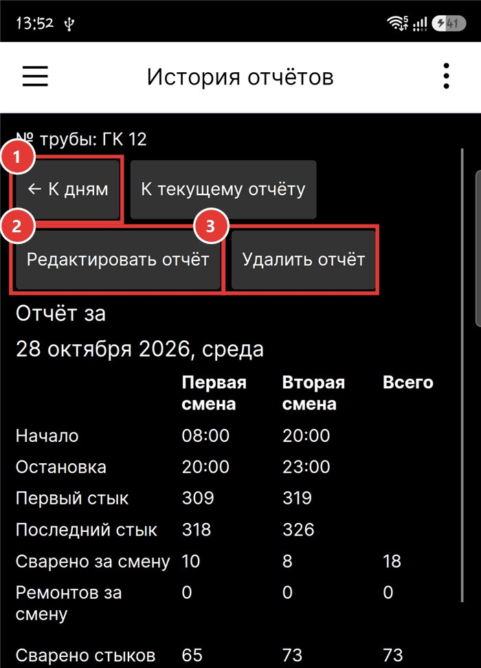

### Исправить отчёт
Нажмите «Редактировать отчёт» (рисунок 8, цифра 2). Отчёт откроется в обычных разделах смен и данных отчёта, а вверху появится жёлтое уведомление о редактировании. Внесите изменения и выберите в меню действий «Сохранить отчёт». Дата при редактировании заблокирована. Расход ЗИП этого отчёта откроется вместе с ним; при включённом учёте ЗИП после сохранения наличие пересчитается.

Чтобы выйти без изменений, нажмите «Отмена» в жёлтом уведомлении или «Отменить редактирование» в меню действий. Сохранённый отчёт останется прежним.

### Сменить номер ГК у сохранённого отчёта
Если вы забыли сменить номер ГК и несколько дней сохраняли отчёты под старым номером:
1. Откройте в истории первый такой отчёт и нажмите «Редактировать отчёт».
2. В шапке укажите правильный «№ Газового коллектора» и выберите в меню действий «Сохранить отчёт».
3. В жёлтом уведомлении программа спросит, точно ли сменить ГК. Нажмите «Сохранить» или «Не сохранять», чтобы вернуться к редактированию.
4. Повторите для остальных отчётов.

Номера стыков пересчитаются в этом отчёте и в отчётах обоих ГК после него; время, количество стыков, комментарии и ЗИП не изменятся. Если за эту дату у нового ГК уже есть отчёт, сохранить не получится.

### Выгрузить и удалить отчёт
Чтобы повторно получить Excel или PDF, откройте нужный отчёт в истории и выберите экспорт в меню действий. Будет выгружен именно открытый сохранённый отчёт.

«Удалить отчёт» (рисунок 8, цифра 3) удаляет выбранную запись после подтверждения кнопкой «Удалить». Месячные итоги пересчитываются, а при включённом учёте ЗИП расход этого отчёта возвращается в наличие. Уже выгруженные Excel и PDF при этом остаются.

Если после запуска поля смен пустые, это не означает, что сохранённый отчёт пропал. После успешного сохранения черновик очищается; для просмотра или исправления готового отчёта откройте историю.

## 12. Настройки
Нажмите три точки справа вверху и выберите «Настройки» (рисунок 3, цифра 5). Экран длинный: прокручивайте его вниз. После изменения настроек нажмите «Сохранить» (рисунок 9, цифра 6). «← Назад» вверху возвращает к отчёту.

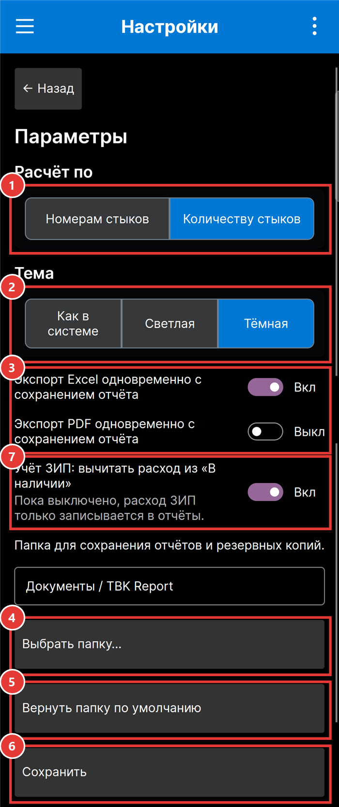

### Выберите удобный способ ввода стыков
Переключатель «Расчёт по» (рисунок 9, цифра 1):
- «Номерам стыков»: вы указываете первый и последний номера, программа считает количество.
- «Количеству стыков»: вы указываете количество в поле «Сварено за смену», программа определяет первый и последний номера.

После установки по умолчанию выбран режим «Количеству стыков». Выбранный режим запоминается.

В обоих режимах учитываются история и начальные данные выбранного ГК. Например, при первом номере 101 и количестве 10 последним будет 110. Количество сваренных стыков должно быть положительным целым числом.

### Выберите тему оформления
Переключатель «Тема» (рисунок 9, цифра 2):
- «Как в системе»: программа светлая или тёмная вместе с телефоном. Выбрано после установки.
- «Светлая»: всегда светлый фон — удобно на улице и при ярком свете.
- «Тёмная»: всегда тёмный фон — меньше слепит вечером и ночью.

Тема меняется после нажатия «Сохранить» и запоминается. При переносе данных она входит в раздел «Настройки» резервной копии.

### Включите автоматический экспорт
Переключатели «Экспорт Excel одновременно с сохранением отчёта» и «Экспорт PDF одновременно с сохранением отчёта» (рисунок 9, цифра 3) работают независимо: можно выбрать один формат или оба.

После успешного сохранения отчёта нужные файлы создаются автоматически. Существующие файлы за ту же дату обновляются. Если экспорт завершился ошибкой, запись уже сохранена в истории: проверьте сообщение программы и повторите выгрузку вручную.

### Включите учёт ЗИП
Переключатель «Учёт ЗИП: вычитать расход из «В наличии»» (рисунок 9, цифра 7) находится под переключателями экспорта. После установки он выключен: расход ЗИП только записывается в отчёты.

Включайте его, когда список «В наличии» заполнен и в нём указана дата «Остатки на дату» ([раздел 6](#6-зип-справочник-комплектующих-и-наличие)). После нажатия «Сохранить» программа сразу вычтет из наличия расход из всех сохранённых отчётов начиная с этой даты, а дальше будет проверять остаток при добавлении расхода в смене.

Если в отчётах с этой даты какой-то детали израсходовано больше, чем указано в «В наличии», учёт не включится: переключатель вернётся в выключенное положение, а программа напишет, каких деталей и сколько не хватает. Исправьте количество или «Остатки на дату» в разделе «В наличии» и включите учёт снова. Остальные настройки при этом сохранятся.

### Выберите папку для экспортных файлов
После установки файлы сохраняются в папку «Документы / TBK Report» на телефоне. Чтобы выбрать другую:
1. Нажмите «Выбрать папку…» (рисунок 9, цифра 4). Откроется системное окно выбора папки.
2. Выберите папку и подтвердите доступ к ней.
3. Нажмите «Сохранить» (рисунок 9, цифра 6).

«Вернуть папку по умолчанию» (рисунок 9, цифра 5) снова выбирает «Документы / TBK Report». В папку экспорта попадают Excel, PDF, отчёты о расходе ЗИП и резервные копии.

### Версия программы
В самом низу экрана настроек написано, какая версия программы установлена, например «ТБК Отчёт · v2.1». Сообщайте её ответственному за программу, если что-то работает не так.

---

## 13. Резервные копии и передача данных другому технику
Если коллеге нужно продолжить ведение отчётов с вашей историей и подготовленными данными, используйте перенос данных. Копию, сделанную на смартфоне, можно загрузить и на компьютер, и наоборот.

Откройте «Настройки» и прокрутите экран до блока «Что включить в резервную копию». Отметьте разделы (рисунок 10, цифра 1): «История», «Проблемы», «Оборудование», «Начальные данные», «Настройки», «Шапка», «Техники и подписи», «Справочник ЗИП» и «ЗИП в наличии». Например, для продолжения работ на другом устройстве можно выбрать все разделы.

Нажмите «Экспорт данных» (рисунок 10, цифра 2). Программа создаст файл «TBK Backup.tbkdata» в папке экспорта. Передайте его коллеге, например через мессенджер. Повторный экспорт заменяет копию с тем же именем; чтобы сохранить предыдущую, заранее переименуйте её или перенесите.

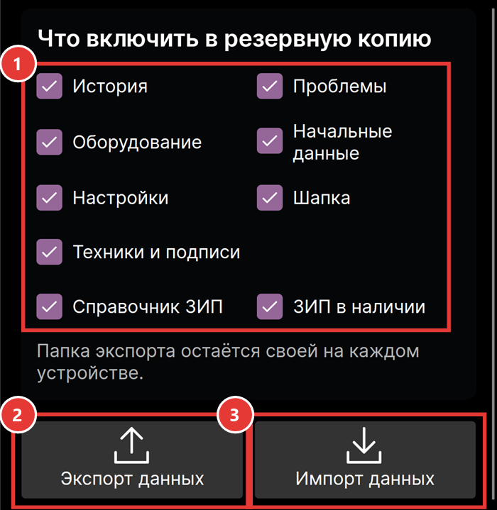

На другом устройстве откройте «Настройки» → «Импорт данных» (рисунок 10, цифра 3), выберите полученный файл, прочитайте сообщение и нажмите «Импортировать».

При переносе важно учитывать:
- Отчёты с совпадающими датами заменяются записями из копии. Другие даты остаются.
- Расход ЗИП переносится вместе с историей отчётов.
- Начальные данные из копии заменяют соответствующие значения для совпадающих месяца и ГК.
- Справочник ЗИП, количество ЗИП в наличии и «Остатки на дату» заменяются данными из копии. Одинаковые детали не дублируются.
- Номера и производитель оборудования переносятся вместе с оборудованием.
- Переносятся только включённые в копию разделы. Техники и подписи выбираются отдельно от шапки.
- Незавершённый черновик и выбранная папка экспорта не переносятся: папка остаётся своей на каждом устройстве.

После импорта закройте программу и откройте её снова, чтобы загрузить переданные данные. Перед началом работы проверьте шапку, номер ГК, оборудование, проблемы, ЗИП в наличии и историю — так же, как при приёме смены на трассе.

---

## 14. Обновление программы
Когда выйдет новая версия, ответственный за программу пришлёт файл APK. Новая версия ставится поверх старой: история, шапка, оборудование, проблемы, ЗИП и настройки сохраняются. Какая версия установлена сейчас, написано внизу экрана настроек.

### Перед обновлением
Сделайте резервную копию, как описано в [разделе 13](#13-резервные-копии-и-передача-данных-другому-технику): откройте «Настройки», отметьте все разделы (рисунок 10, цифра 1) и нажмите «Экспорт данных» (рисунок 10, цифра 2). Если при обновлении что-то пойдёт не так, данные можно будет вернуть через «Импорт данных».

### Установка новой версии
1. Не удаляйте старую версию перед обновлением: удаление приложения стирает его историю и настройки.
2. Скачайте APK новой версии и откройте его.
3. Android спросит «Обновить приложение?». Нажмите «Обновить» (рисунок 11, цифра 1).
4. Откройте программу и проверьте историю, шапку и настройки.

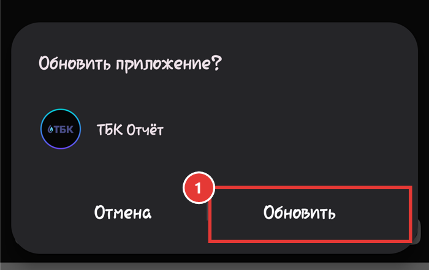

Если Android пишет, что приложение не установлено или подпись не совпадает, не удаляйте старую версию: сначала сделайте резервную копию и сообщите ответственному за программу.
