# ТБК Отчёт
## Руководство пользователя · версия 2.x

## Содержание
- Возможности программы
1. Вы приехали на трассу и принимаете смену
2. Заполните шапку отчёта
3. Заполнение списка с оборудованием
4. Уточните проблемные вопросы
5. ЗИП: справочник комплектующих и наличие
6. Подготовьте нумерацию: новый или уже начатый коллектор
7. Заполняйте отчёт по ходу работы
8. Сохраните и отправьте отчёт
9. Закончили старый коллектор и начинаете новый
10. История: найти, исправить или повторно выгрузить отчёт
11. Настройки
12. Резервные копии и передача данных другому технику
13. Чем отличается интерфейс Windows и Android
14. Обновление программы

---

## Возможности программы
Программа предназначена для подготовки ежедневных отчётов о сварочно-монтажных работах. Она объединяет сведения о двух сменах, считает сваренные стыки и ремонты, сохраняет историю и экспортирует отчёты в Excel и PDF.

Возможности программы:
- Ведение первой и второй смены: время работы, номера и количество стыков, ремонты, комментарии.
- Расчёт количества по номерам стыков или определение номеров по введённому количеству.
- Учёт нарастающих итогов за месяц и продолжение нумерации по ГК.
- Заполнение шапки отчёта, списка техников и их рукописных подписей.
- Ведение оборудования и проблемных вопросов.
- Учёт ЗИП: справочник комплектующих, количество в наличии и расход за каждую смену.
- Просмотр, исправление и удаление сохранённых отчётов.
- Ручной и автоматический экспорт в Excel и PDF.
- Восстановление незавершённой работы и перенос данных через резервную копию.

## 1. Вы приехали на трассу и принимаете смену
Перед первым отчётом уточните у техника, которого меняете, состояние работ. Эти сведения понадобятся при заполнении программы:
- На каком объекте и комплексе ведутся работы, какая труба используется и какой номер у текущего ГК.
- Кто работает техником в каждой смене.
- Какое оборудование есть на участке, сколько единиц находится в работе и сколько в резерве.
- Какой ЗИП есть в наличии и сколько каждой позиции.
- Какие проблемы остаются нерешёнными и что необходимо отразить в отчёте.
- Начинается ли сварка коллектора с нуля или часть стыков уже сварена. Если работы идут, узнайте последний номер стыка, количество сваренных стыков и ремонтов за текущий месяц.

Все скриншоты в руководстве пронумерованы. Ссылка вида «рисунок 2, цифра 3» означает: на рисунке 2 найдите красную рамку с цифрой 3.

Слева в окне программы находятся кнопки разделов: «Отчёт», «История», «ЗИП» и «Параметры» (рисунок 1, цифра 7). Открытый раздел подсвечен синим. Кнопка «Отчёт» в любой момент возвращает к заполнению отчёта.

Запустите программу и проверьте «Дату отчёта» (рисунок 1, цифра 1). Затем откройте вкладку «Данные отчёта» (рисунок 1, цифра 4). Сначала заполните шапку, оборудование и проблемы, затем ЗИП в наличии, а после этого подготовьте данные для нумерации стыков.

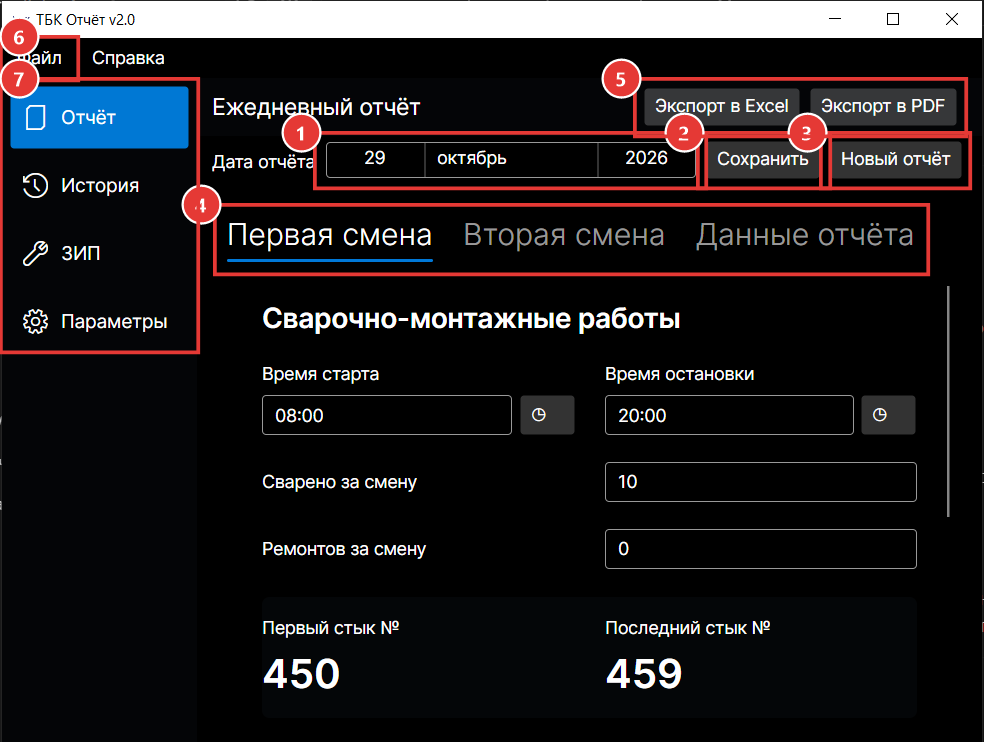

---

## 2. Заполните шапку отчёта
Откройте «Данные отчёта» → «Шапка отчёта» (рисунок 2, цифра 1). Внесите в поля шапки (рисунок 2, цифра 2) сведения, полученные при приёме смены:
- «Заказчик» — наименование заказчика.
- «Проект» — название проекта.
- «Участок» — участок, на котором выполняются работы.
- «Комплекс» — обозначение вашего комплекса.
- «Труба» — параметры используемой трубы.
- «№ Газового коллектора» (рисунок 2, цифра 3) — номер коллектора, на котором вы работаете. Без него отчёт не сохранится. Можно указать любое целое число, в том числе 0 и отрицательное.

Номер ГК особенно важен: по нему программа распределяет отчёты по коллекторам. Проверьте номер перед началом заполнения смен.

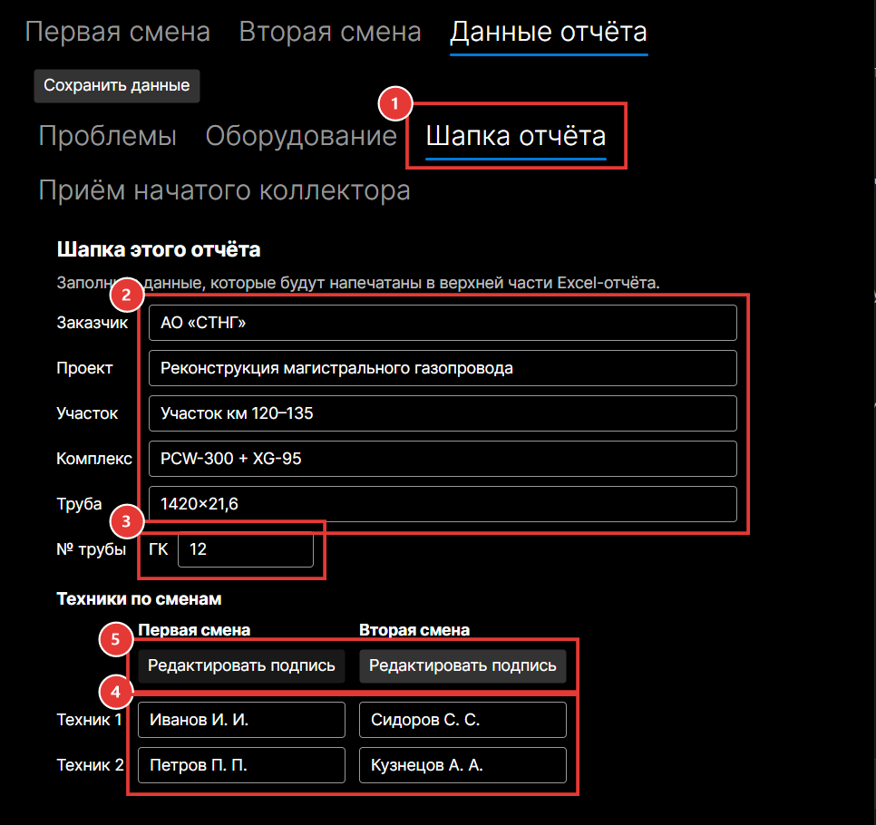

### Укажите техников и добавьте подписи
Заполните фамилии и инициалы техников первой и второй смен (рисунок 2, цифра 4). Для каждой смены предусмотрено до двух техников.

После заполнения поля «Техник 1» над ним появляется кнопка подписи (рисунок 2, цифра 5; рисунок 3, цифра 1). Нажмите её и нарисуйте подпись в белом поле (рисунок 3, цифра 2), удерживая левую кнопку мыши. При работе с тачпадом можно удерживать Shift и перемещать указатель.

В редакторе подписи «Очистить» (рисунок 3, цифра 3) позволяет нарисовать её заново, «Сохранить» (рисунок 3, цифра 4) принимает результат, а «Отмена» (рисунок 3, цифра 5) возвращает прежнюю подпись. Подпись будет включена в Excel и PDF. Если удалить имя первого техника, его подпись тоже удалится.

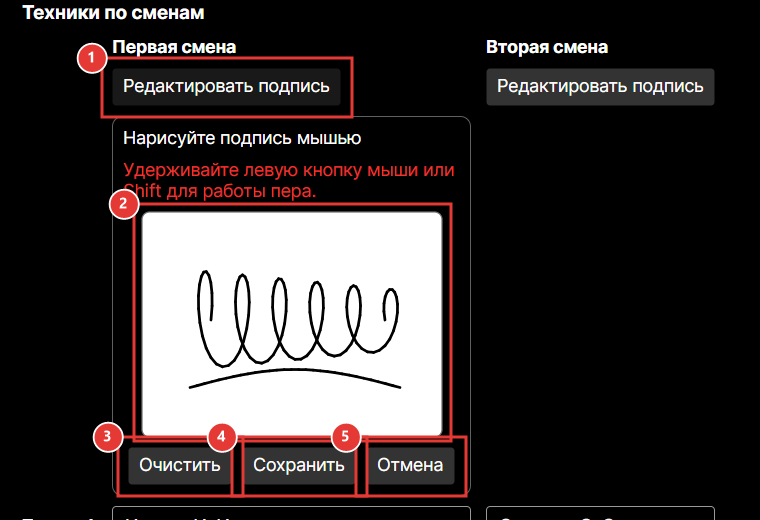

## 3. Заполнение списка с оборудованием
Откройте «Данные отчёта» → «Оборудование» (рисунок 4, цифра 1). Сверьте список с техником, которого меняете, и внесите фактическое количество оборудования.

Обозначения в программе и отчёте:
- «Рб» — в работе: сколько единиц оборудования задействовано в работе.
- «Рз» — в резерве: сколько единиц оборудования находится в резерве.

Например, если два аппарата используются, а один находится в резерве, укажите для этого оборудования «Рб: 2» и «Рз: 1». Если резерва нет, укажите 0.

Для каждой позиции заполните название и оба количества (рисунок 4, цифра 2), затем нажмите «Добавить оборудование» (рисунок 4, цифра 3). Кнопками «Изменить» и «Удалить» (рисунок 4, цифра 4) можно исправить сведения. Количества вводятся целыми неотрицательными числами.

Для отчёта о расходе ЗИП за месяц впишите в поле «Номера» номера оборудования (например, «10033, 10032») и выберите в списке «Производитель» его производителя.

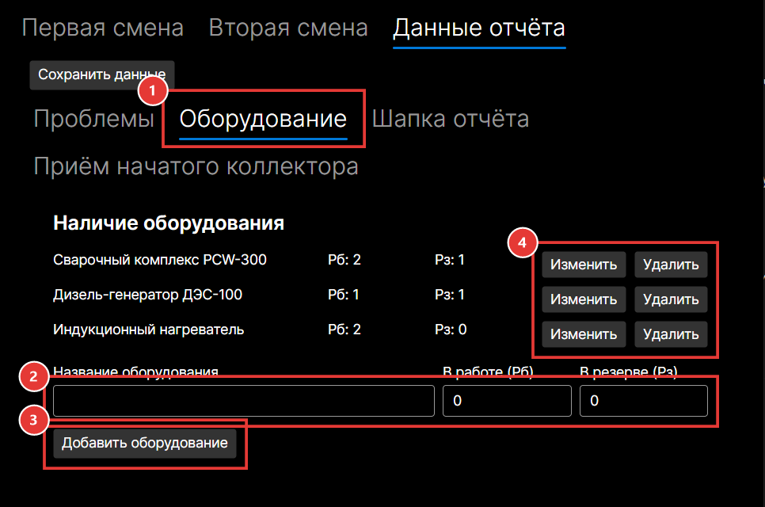

## 4. Уточните проблемные вопросы
Откройте «Данные отчёта» → «Проблемы» (рисунок 5, цифра 1). Уточните у сменяемого техника, какие вопросы ещё не решены: например, неисправности оборудования, нехватка расходных материалов или ожидаемые поставки. Внесите актуальные проблемы отдельными пунктами: напишите текст (рисунок 5, цифра 2) и нажмите «Добавить проблему» (рисунок 5, цифра 3).

В этом разделе время не указывается. События конкретной смены с привязкой ко времени добавляются позднее в комментарии смены. Проблемы можно изменять и удалять кнопками «Изменить» и «Удалить» (рисунок 5, цифра 4); программа сама обновляет их нумерацию.

Шапка, оборудование и проблемы сохраняются сами: поле шапки — когда вы переходите из него в другое место, проблема или оборудование — после нажатия «Добавить», «Сохранить изменения» или «Удалить». Эти сведения будут доступны при следующих запусках. В дальнейшем обновляйте их при изменении состава техников, оборудования или текущих проблем.

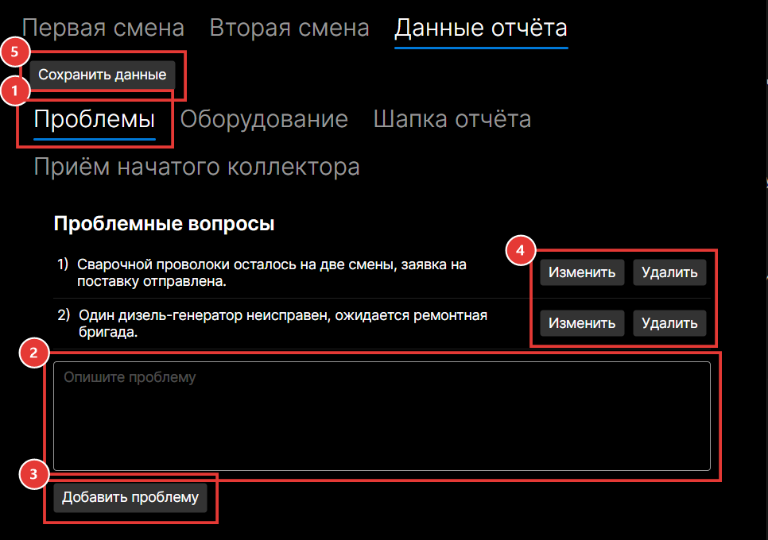

---

## 5. ЗИП: справочник комплектующих и наличие
ЗИП — запасные части и расходники для оборудования: наконечники, сопла, диффузоры и так далее. Программа ведёт два списка и записывает, сколько ЗИП израсходовано в каждой смене. В Excel и PDF расход ЗИП не попадает.

Нажмите «ЗИП» слева (рисунок 6, цифра 1). В разделе две вкладки:
- «Комплектующие» — справочник: все детали, которые вообще бывают, с наименованием, артикулом и производителем. Количества здесь нет.
- «В наличии» — какие детали из справочника есть у вас и сколько штук.

Обе вкладки устроены одинаково: сверху поле поиска, рядом кнопка «+ Добавить», ниже список. Поиск находит деталь по части наименования, артикула или производителя; заглавные буквы и пробелы значения не имеют. Например, «тт552» найдёт «ТТ 552-2101». Текст в списках можно выделить мышью и скопировать.

### Справочник комплектующих
Справочник уже заполнен деталями комплекса «Альфа» производства «Технотрон» и частью деталей «Xionggu Electrical». Проверьте его и при необходимости дополните.

Откройте вкладку «Комплектующие» (рисунок 6, цифра 2). Чтобы найти деталь, начните вводить её название или артикул в поле поиска (рисунок 6, цифра 3).

Чтобы добавить деталь, нажмите «+ Добавить» справа от поля поиска. Появится форма (рисунок 6, цифра 4): заполните «Наименование», «Артикул (каталожный номер)» и «Производитель» и нажмите «Добавить комплектующую». Обязательно только наименование. При вводе производителя программа подсказывает уже известных производителей по первым буквам — выберите нужного из списка. «Отмена» закрывает форму без сохранения.

Кнопками «Изменить» и «Удалить» (рисунок 6, цифра 5) можно исправить или убрать деталь. «Изменить» открывает ту же форму с данными детали. Деталь, которая есть в списке «В наличии», удалить нельзя: сначала уберите её оттуда.

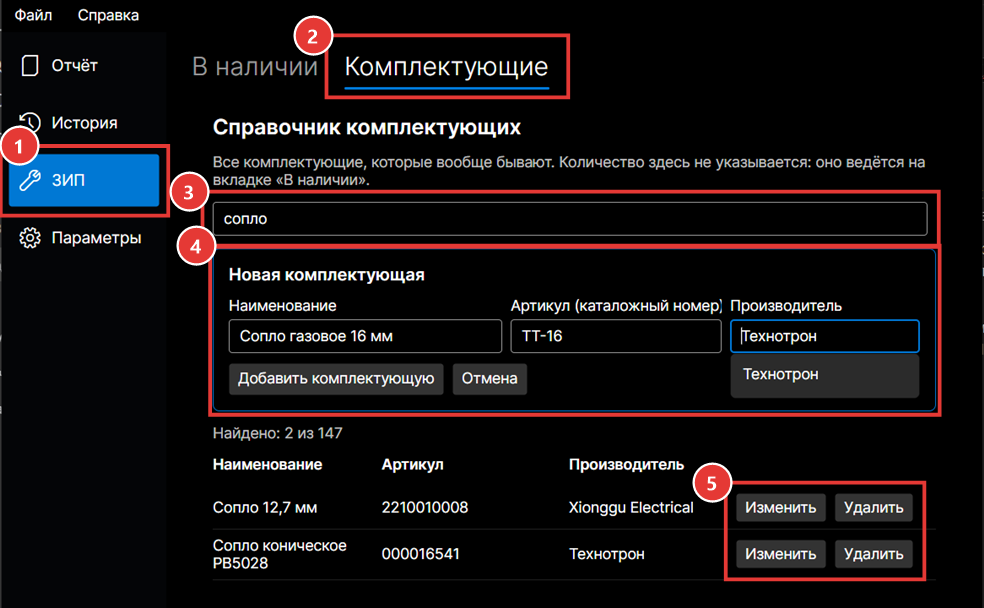

### ЗИП в наличии
Список «В наличии» заполняется один раз, при приёме смены: пересчитайте ЗИП вместе с техником, которого меняете. В поле «Остатки на дату» (рисунок 7, цифра 6) укажите день, когда пересчитали.

Количество в наличии уменьшается само, только если в «Параметрах» включён «Учёт ЗИП» ([раздел 11](#11-настройки)). Тогда программа вычитает из пересчитанного количества расход ЗИП из всех сохранённых отчётов, начиная с даты «Остатки на дату». Пока учёт выключен, расход ЗИП только записывается в отчёты, а количество в наличии не меняется. Над списком написано, включён ли учёт.

Учёт можно включить и позже: программа сразу пройдёт по уже сохранённым отчётам начиная с этой даты и вычтет их расход.

1. Откройте вкладку «В наличии» (рисунок 7, цифра 1).
2. Нажмите «+ Добавить» справа от поля поиска — появится форма «Добавление в наличие».
3. В поле «Найти в справочнике» начните вводить название или артикул и выберите деталь в списке под ним (рисунок 7, цифра 3). Если найдена одна деталь, она выбирается сама. Детали, которые уже есть в наличии, показаны зелёным: если выбрать такую, введите, сколько штук лежит сейчас.
4. Введите количество (рисунок 7, цифра 4) и нажмите «Добавить в наличие».

Если пришла новая партия ЗИП или вы нашли ошибку, нажмите «Изменить» (рисунок 7, цифра 5) и введите, сколько штук лежит сейчас. «Удалить» убирает позицию из наличия; в справочнике она остаётся. Найти позицию в длинном списке поможет поиск (рисунок 7, цифра 2).

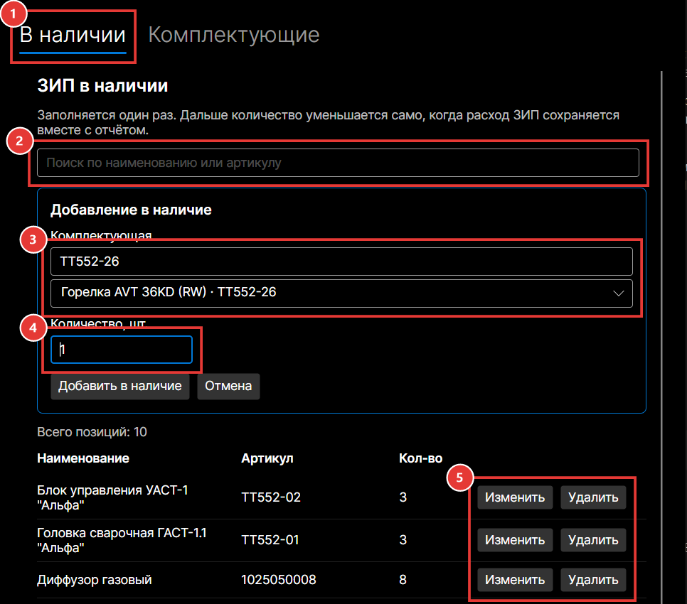

### Отчёт о расходе ЗИП за месяц
1. Откройте вкладку «Отчёт за месяц».
2. Выберите месяц в списке «Месяц». Под ним появится, сколько ЗИП списано за этот месяц.
3. Нажмите «Создать отчёт». PDF сохранится в папку экспорта.

Если такой отчёт уже есть в папке, нажмите «Заменить» или «Отмена».

---

## 6. Подготовьте нумерацию: новый или уже начатый коллектор
Перед первым отчётом определите, с какого состояния вы начинаете работу в программе.

### Коллектор начинают варить с нуля
Укажите его номер ГК в шапке (рисунок 2, цифра 3). Программа начнёт нумерацию с первого стыка. Начальные данные заполнять не нужно — можно переходить к заполнению смен.

Первый номер подставляется после ввода времени старта смены (рисунок 9, цифра 1): программа покажет его в поле «Первый стык №» (рисунок 9, цифра 5). Если в первой смене сварки не было, работу можно начать со второй.

### Коллектор уже начали варить
Если предыдущие работы ещё не внесены в историю программы, обязательно заполните начальные данные до первого отчёта. Иначе программа не сможет правильно продолжить нумерацию и учесть ранее выполненные работы в месячном итоге.

Уточните значения у техника, которого меняете, и сверьте их с предыдущим отчётом. Затем:
1. Проверьте месяц в дате отчёта и номер ГК: он показан над полями (рисунок 8, цифра 2).
2. Откройте «Данные отчёта» → «Приём начатого коллектора» (рисунок 8, цифра 1).
3. В поле «Последний номер стыка» (рисунок 8, цифра 3) внесите номер последнего уже сваренного стыка этого коллектора.
4. В поле «Сварено стыков за месяц» внесите количество, уже сваренное в текущем месяце до начала ваших отчётов.
5. В поле «Ремонтов за месяц» внесите накопленное количество ремонтов за текущий месяц. Если ремонтов не было, укажите 0.
6. Нажмите «Сохранить начальные данные» (рисунок 8, цифра 4).

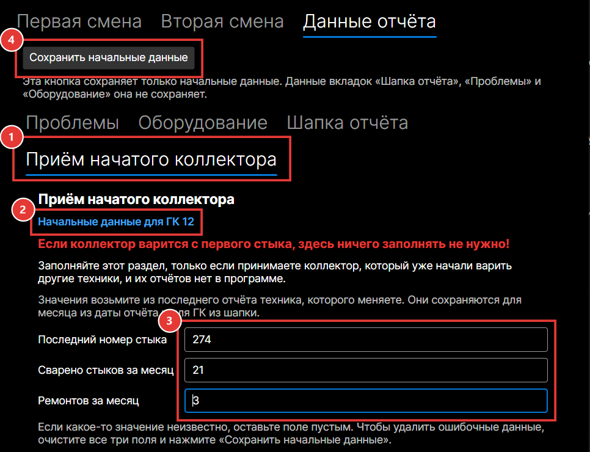

Например, последний сваренный стык — 274, за текущий месяц сварен 21 стык и выполнено 3 ремонта. Введите соответственно 274, 21 и 3. Следующим будет стык 275, а месячные количества продолжатся от 21 стыка и 3 ремонтов.

Последний номер стыка и количество за месяц — разные значения. Если коллектор начали в прошлом месяце, в месячное количество не нужно включать все стыки с начала его сварки.

Если предыдущие отчёты уже есть в истории программы, повторно включать эти работы в начальные данные не нужно: они будут учтены дважды. При приёме готовой истории проверьте её полноту и уже внесённые начальные данные.

### Если в начальных данных допущена ошибка
Чтобы заменить сохранённые значения, очистите все три поля и нажмите «Сохранить начальные данные». После этого внесите правильные значения и сохраните их снова. Перед изменением проверьте выбранные месяц и ГК.

---

## 7. Заполняйте отчёт по ходу работы
Откройте «Первую смену» или «Вторую смену» — ту, за которую вносите сведения. Проверьте дату: именно за неё будет сохранён отчёт.

### Начало и окончание сварки
Укажите «Время старта» (рисунок 9, цифра 1). Программа предложит первый номер стыка с учётом выбранного ГК, начальных данных и предыдущих отчётов. В конце работ укажите «Время остановки» (рисунок 9, цифра 2) и последний сваренный стык.

В обычном режиме количество считается по первому и последнему номерам включительно. Например, стыки с 275 по 284 — это 10 стыков. Второй смене программа предложит продолжить нумерацию со стыка 285.

В поле «Ремонтов за смену» (рисунок 9, цифра 4) укажите количество ремонтов. Если их не было, введите 0.

Можно работать и по количеству стыков, как на рисунке 9: вы вводите число в поле «Сварено за смену» (рисунок 9, цифра 3), а программа рассчитывает первый и последний номера (рисунок 9, цифра 5). Переключение режима описано в [разделе 11 «Настройки»](#11-настройки).

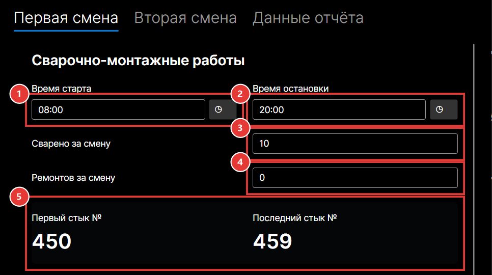

Ниже полей смены находятся две вкладки: «Комментарии смены» и «Расход ЗИП» (рисунок 10, цифра 1; рисунок 11, цифра 1). На экране видна одна из них — переключайтесь между ними нажатием на название вкладки.

### Записывайте события смены
Откройте вкладку «Комментарии смены» (рисунок 10, цифра 1). Укажите время (рисунок 10, цифра 3) и текст события (рисунок 10, цифра 4). Если событие длилось продолжительное время, включите «Диапазон времени» (рисунок 10, цифра 2) и заполните начало и конец. Например: «10:00–11:30 — ожидание трубы». Затем нажмите «Добавить комментарий» (рисунок 10, цифра 5).

Программа расставляет записи по возрастанию времени начала события. Комментарии можно изменять и удалять кнопками «Изменить» и «Удалить» (рисунок 10, цифра 6). При вводе времени старта и остановки автоматически появляются записи «Старт СМР» и «Стоп СМР». При изменении времени эти записи обновляются.

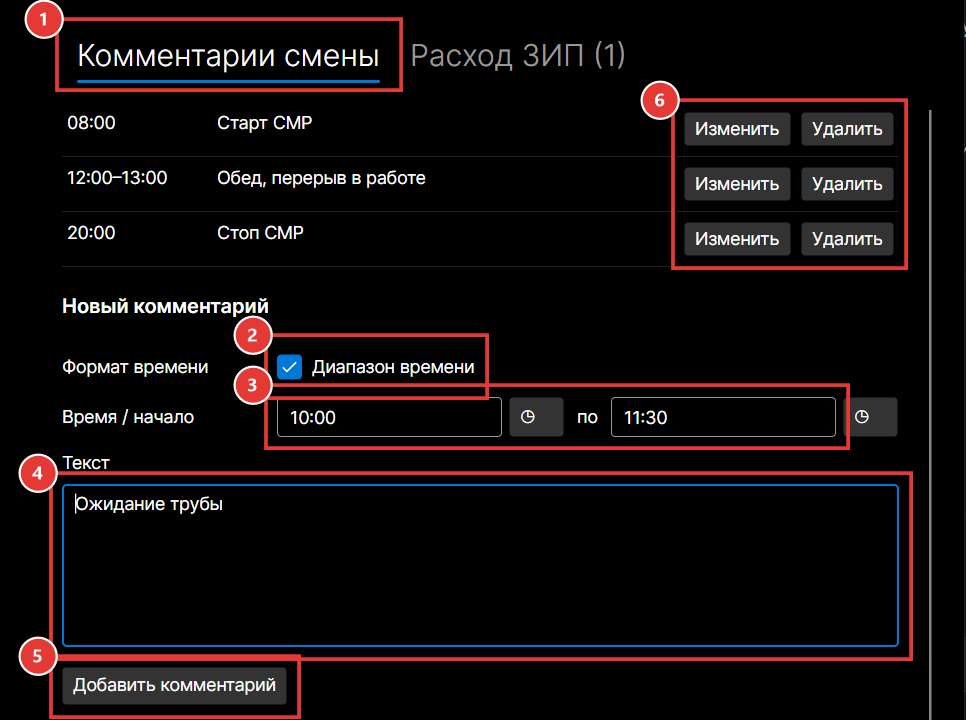

### Записывайте расход ЗИП
Если в смене израсходован ЗИП — например, вы выдали два наконечника для сварочного аппарата, — отметьте это в отчёте:
1. Откройте вкладку «Расход ЗИП» (рисунок 11, цифра 1).
2. В поле поиска (рисунок 11, цифра 2) начните вводить название или артикул детали.
3. Выберите деталь в списке (рисунок 11, цифра 3).
4. Введите количество (рисунок 11, цифра 4) и нажмите «Добавить в расход» (рисунок 11, цифра 5).

Если одну и ту же деталь добавить дважды, количества сложатся в одной строке. Ошибочную строку можно исправить или убрать кнопками «Изменить» и «Удалить» (рисунок 11, цифра 6). До сохранения отчёта расход хранится в черновике вместе с остальными полями смены.

Что происходит дальше, зависит от «Учёта ЗИП» в «Параметрах»:
- Учёт выключен. В списке детали из «В наличии», но остаток рядом не показывается и количество не проверяется. Расход сохраняется вместе с отчётом, а количество в наличии не меняется.
- Учёт включён. Рядом с каждой деталью показано, сколько её ещё можно списать. Списать больше программа не даст: она сразу сообщит, сколько штук можно. Обе смены отчёта берут ЗИП из одного наличия. После «Сохранить» расход вычитается из наличия; если позже исправить сохранённый отчёт, наличие пересчитается, а если удалить отчёт из истории, его ЗИП вернётся в наличие. Отчёты с датой раньше «Остатков на дату» не проверяются и из наличия не вычитаются.

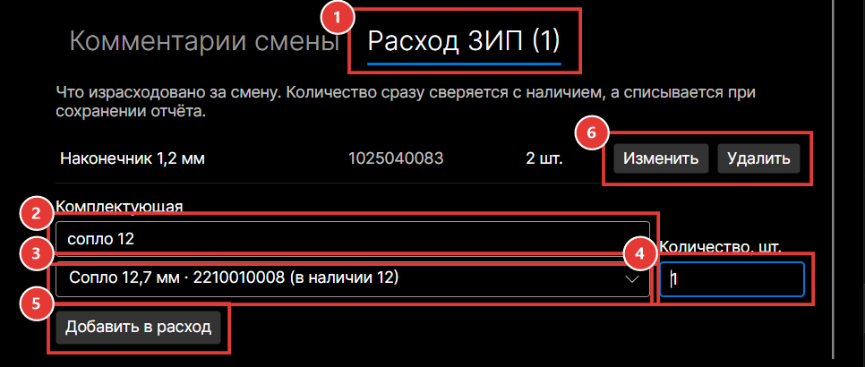

### Если сварки не было
Добавьте комментарий со временем и причиной, например: «08:00–19:00 — сломана головная АПС». Не вводите вымышленные номера стыков или время старта и окончания сварки.

Отчёт без сварки можно сохранить и экспортировать, если добавлен хотя бы один комментарий со временем. В такой смене оставьте пустыми время старта и остановки, стыки и ремонты. Если время старта указано, заполните все поля смены. Программа подсветит красным поля, которые нужно исправить.

### Если пришлось закрыть программу
Незавершённые поля смен, комментарии и расход ЗИП автоматически сохраняются в черновик и восстанавливаются при следующем запуске. Шапка, оборудование и проблемы сохраняются сами, отдельной кнопки для них нет.

---

## 8. Сохраните и отправьте отчёт
После заполнения смен проверьте дату, номер ГК, номера стыков, ремонты, комментарии и расход ЗИП. При необходимости обновите оборудование и проблемные вопросы.

Нажмите «Сохранить» рядом с датой (рисунок 1, цифра 2). Это добавит отчёт в историю вместе с его шапкой, подписями, оборудованием, проблемами и расходом ЗИП; при включённом учёте ЗИП расход вычтется из наличия. Если в форме расхода ЗИП осталась недобавленная строка, программа попросит сначала добавить её или очистить поля.

Затем нажмите «Экспорт в Excel» или «Экспорт в PDF» (рисунок 1, цифра 5) и передайте полученный файл коллегам. Эти же команды доступны в меню «Файл» (рисунок 1, цифра 6). Если одноимённый файл уже существует, при ручном экспорте программа предложит заменить его.

«Сохранить» рядом с датой (рисунок 1, цифра 2) фиксирует ежедневный отчёт в истории, а «Экспорт в Excel» и «Экспорт в PDF» (рисунок 1, цифра 5) создают файл для отправки. Сам по себе экспорт не добавляет отчёт в историю.

За одну дату сохраняется один отчёт для каждого ГК. Повторно сохранить его нельзя: чтобы исправить сохранённый отчёт, откройте его в истории ([раздел 10](#10-история-найти-исправить-или-повторно-выгрузить-отчёт)).

### Как читать месячные итоги
Месячные показатели учитывают начальные данные и отчёты по всем ГК с начала месяца по дату отчёта. При смене ГК они не начинаются заново — только с нового месяца. В первой и второй сменах показан нарастающий итог.

Например, ранее в месяце было сварено 100 стыков, первая смена сварила 10, а вторая — 8. В месячных показателях будет 110 после первой смены, 118 после второй и 118 в графе «Всего». Складывать 110 и 118 не нужно.

### Следующий день
После сохранения завершённого отчёта нажмите «Новый отчёт» (рисунок 1, цифра 3) и проверьте дату следующего отчёта. Если остались несохранённые изменения, программа запросит подтверждение их удаления.

Для того же ГК нумерация продолжится по истории, в том числе при переходе на новый месяц. Начальные данные не нужно заново вводить каждый день или переносить в них итог предыдущего месяца.

## 9. Закончили старый коллектор и начинаете новый
1. Сохраните отчёт по завершённому коллектору и выгрузите его при необходимости.
2. Подготовьте новый отчёт и откройте «Данные отчёта» → «Шапка отчёта».
3. Измените «№ Газового коллектора» (рисунок 2, цифра 3) на номер нового коллектора — он сохранится сам, когда вы перейдёте в другое поле.
4. Переходите к заполнению смен по новому коллектору.

Если новый ГК ещё не имеет отчётов и начальных данных, программа начнёт нумерацию стыков заново — с первого стыка. Сварено и ремонтов за месяц продолжат считаться с начала месяца, вместе со стыками старого ГК.

Если выбранный ГК уже варили и его данные есть в программе, нумерация продолжится с номера последнего отчёта. Если его начали варить, но этих работ в программе ещё нет, сначала заполните начальные данные, как описано в [разделе 6](#6-подготовьте-нумерацию-новый-или-уже-начатый-коллектор).

Кнопка «Новый отчёт» сама по себе не меняет номер ГК.

Если переход между коллекторами произошёл в один день, сохраните отчёт по старому ГК, затем смените номер ГК в шапке (рисунок 2, цифра 3), заполните смены по новому ГК и сохраните второй отчёт за ту же дату.

---

## 10. История: найти, исправить или повторно выгрузить отчёт
Нажмите «История» слева (рисунок 12, цифра 1), выберите месяц и год (рисунок 12, цифра 2), затем день (рисунок 13, цифра 1). Если за день сохранены отчёты по двум ГК, день будет показан двумя строками с номерами ГК — выберите нужную. Здесь можно посмотреть смены, дневные и месячные показатели, комментарии, оборудование и проблемы.

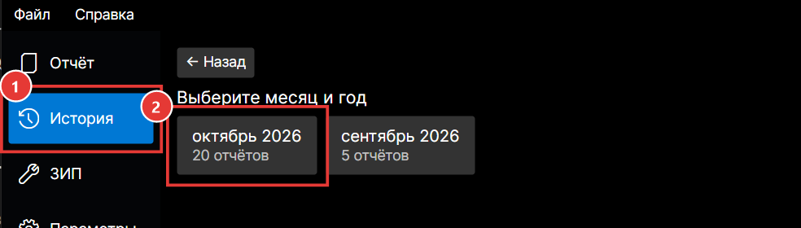

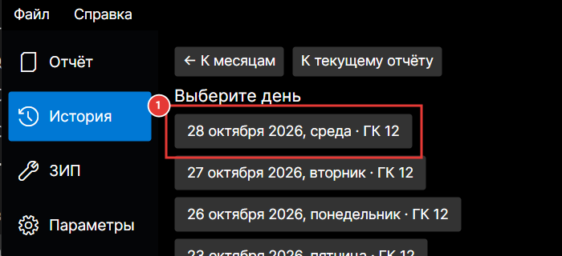

Чтобы исправить запись, нажмите «Редактировать отчёт» (рисунок 14, цифра 1), внесите изменения и нажмите «Сохранить». Дата при редактировании заблокирована. Расход ЗИП этого отчёта откроется вместе с ним; при включённом учёте ЗИП после сохранения наличие пересчитается. Кнопка «Отмена» вернёт вас к обычному черновику без изменения сохранённого отчёта.

Если вы забыли сменить номер ГК и несколько дней сохраняли отчёты под старым номером, откройте каждый такой отчёт в истории, нажмите «Редактировать отчёт», укажите в шапке правильный «№ Газового коллектора» и нажмите «Сохранить». Программа попросит подтвердить смену ГК — нажмите «Сохранить» ещё раз. Номера стыков пересчитаются в этом отчёте и в отчётах обоих ГК после него; время, количество стыков, комментарии и ЗИП не изменятся. Если за эту дату у нового ГК уже есть отчёт, сохранить не получится.

Чтобы повторно получить Excel или PDF, откройте нужный день истории и выберите экспорт в меню «Файл» (рисунок 14, цифра 3). Будет выгружен именно открытый сохранённый отчёт.

«Удалить отчёт» (рисунок 14, цифра 2) удаляет выбранную запись после подтверждения. Месячные итоги пересчитываются, а при включённом учёте ЗИП расход этого отчёта возвращается в наличие. Уже выгруженные Excel и PDF при этом остаются.

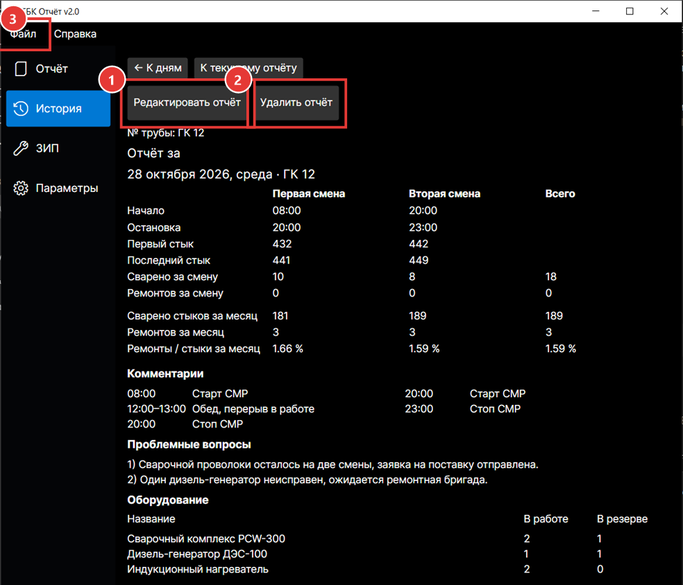

Если после запуска поля смен пустые, это не означает, что сохранённый отчёт пропал. После успешного сохранения черновик очищается; для просмотра или исправления готового отчёта откройте историю.

## 11. Настройки
Нажмите «Параметры» слева (рисунок 15, цифра 1). После изменения настроек нажмите «Сохранить» (рисунок 15, цифра 6).

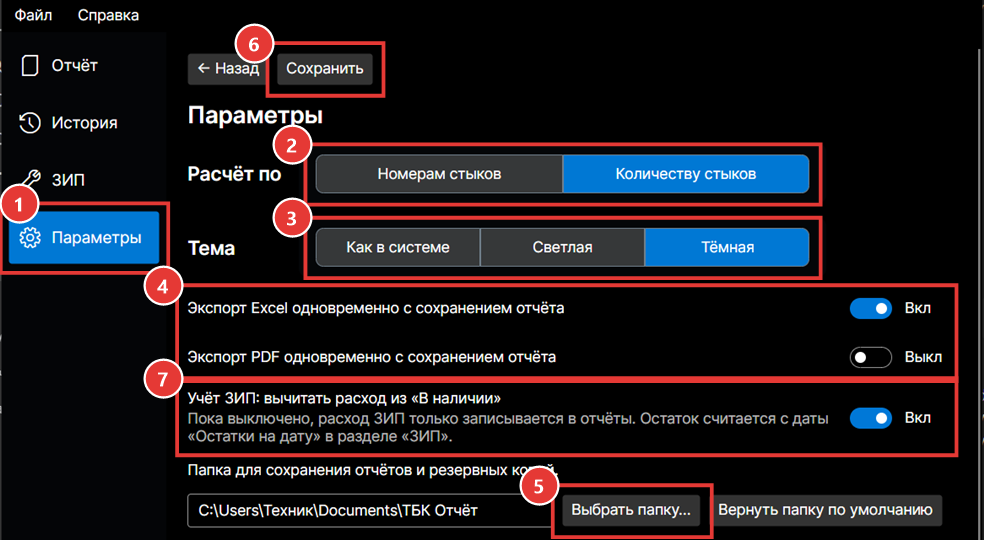

### Выберите удобный способ ввода стыков
Переключатель «Расчёт по» (рисунок 15, цифра 2):
- «Номерам стыков»: вы указываете первый и последний номера, программа считает количество.
- «Количеству стыков»: вы указываете количество в поле «Сварено за смену», программа определяет первый и последний номера.

После установки по умолчанию выбран режим «Количеству стыков». Выбранный режим запоминается.

В обоих режимах учитываются история и начальные данные выбранного ГК. Например, при первом номере 101 и количестве 10 последним будет 110. Количество сваренных стыков должно быть положительным целым числом.

### Выберите тему оформления
Переключатель «Тема» (рисунок 15, цифра 3):
- «Как в системе»: программа светлая или тёмная вместе с Windows или телефоном. Выбрано после установки.
- «Светлая»: всегда светлый фон — удобно на улице и при ярком свете.
- «Тёмная»: всегда тёмный фон — меньше слепит вечером и ночью.

Тема меняется после нажатия «Сохранить» и запоминается. При переносе данных она входит в раздел «Настройки» резервной копии.

### Включите автоматический экспорт
Переключатели «Экспорт Excel одновременно с сохранением отчёта» и «Экспорт PDF одновременно с сохранением отчёта» (рисунок 15, цифра 4) работают независимо: можно выбрать один формат или оба.

После успешного сохранения отчёта нужные файлы создаются автоматически. Существующие файлы за ту же дату обновляются. Если экспорт завершился ошибкой, запись уже сохранена в истории: проверьте сообщение программы и повторите выгрузку вручную.

### Включите учёт ЗИП
Переключатель «Учёт ЗИП: вычитать расход из «В наличии»» (рисунок 15, цифра 7) находится под переключателями экспорта. После установки он выключен: расход ЗИП только записывается в отчёты.

Включайте его, когда список «В наличии» заполнен и в нём указана дата «Остатки на дату» ([раздел 5](#5-зип-справочник-комплектующих-и-наличие)). После нажатия «Сохранить» программа сразу вычтет из наличия расход из всех сохранённых отчётов начиная с этой даты, а дальше будет проверять остаток при добавлении расхода в смене.

Если в отчётах с этой даты какой-то детали израсходовано больше, чем указано в «В наличии», учёт не включится: переключатель вернётся в выключенное положение, а программа напишет, каких деталей и сколько не хватает. Исправьте количество или «Остатки на дату» в разделе «ЗИП» и включите учёт снова. Остальные настройки при этом сохранятся. При переносе данных переключатель входит в раздел «Настройки» резервной копии.

### Выберите папку для экспортных файлов
Нажмите «Выбрать папку…» (рисунок 15, цифра 5), укажите удобное место для отчётов и нажмите «Сохранить» (рисунок 15, цифра 6). В эту папку будут попадать Excel, PDF и резервные копии.

---

## 12. Резервные копии и передача данных другому технику
Если коллеге нужно продолжить ведение отчётов с вашей историей и подготовленными данными, используйте перенос данных.

В «Параметрах» отметьте, что включить в резервную копию (рисунок 16, цифра 1): историю, проблемы, оборудование, начальные данные, настройки, шапку, техников и подписи, справочник ЗИП и ЗИП в наличии. Например, для продолжения работ на другом устройстве можно выбрать все разделы.

Нажмите «Экспорт данных» (рисунок 16, цифра 2). Программа создаст файл «TBK Backup.tbkdata» в выбранной папке экспорта. Передайте его коллеге. Повторный экспорт заменяет копию с тем же именем; чтобы сохранить предыдущую, заранее переименуйте её или перенесите.

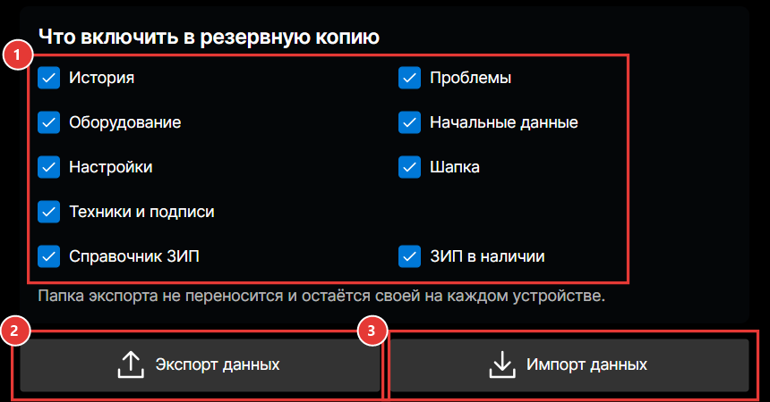

На другом устройстве откройте «Параметры» → «Импорт данных» (рисунок 16, цифра 3), выберите полученный файл, прочитайте сообщение и подтвердите импорт.

При переносе важно учитывать:
- Отчёты с совпадающими датами заменяются записями из копии. Другие даты остаются.
- Расход ЗИП переносится вместе с историей отчётов.
- Начальные данные из копии заменяют соответствующие значения для совпадающих месяца и ГК.
- Справочник ЗИП, количество ЗИП в наличии и «Остатки на дату» заменяются данными из копии. Одинаковые детали не дублируются.
- Переносятся только включённые в копию разделы. Техники и подписи выбираются отдельно от шапки.
- Незавершённый черновик и выбранная папка экспорта не переносятся.

После импорта перезапустите программу, чтобы загрузить переданные данные по умолчанию. Перед началом работы проверьте шапку, номер ГК, оборудование, проблемы, ЗИП в наличии и историю — так же, как при приёме смены на трассе.

---

## 13. Чем отличается интерфейс Windows и Android
Порядок подготовки отчёта на смартфоне остаётся тем же: шапка, оборудование, проблемы, ЗИП в наличии, при необходимости приём начатого коллектора и заполнение смен. Шаги из [разделов 1–12](#1-вы-приехали-на-трассу-и-принимаете-смену) показаны для Windows; на Android нужные разделы и команды расположены следующим образом.

### Переход между разделами
В Windows разделы «Отчёт», «История», «ЗИП» и «Параметры» открываются кнопками слева. Смены открываются вкладками «Первая смена» и «Вторая смена». Проблемы, оборудование, шапка и приём начатого коллектора находятся внутри вкладки «Данные отчёта».

На Android название открытого раздела крупно написано на синей полосе вверху экрана — всегда сверяйтесь с ним, чтобы не заполнить не ту смену или не тот раздел.

Разделы на Android собраны в группы. Внутри группы разделы листаются горизонтальным движением пальца — смахиванием влево или вправо:
- смены: «Первая смена» и «Вторая смена»;
- данные отчёта: «Проблемы», «Оборудование», «Шапка отчёта» и «Приём начатого коллектора»;
- ЗИП: «В наличии», «Комплектующие» и «Отчёт за месяц».

Смахиванием нельзя перейти из одной группы в другую. Для этого нажмите кнопку с тремя горизонтальными полосками в левом верхнем углу (рисунок 17, цифра 1) и в боковом меню выберите смену (рисунок 18, цифра 1), один из разделов группы «Данные отчёта» (рисунок 18, цифры 2 и 3) или группы «ЗИП» (рисунок 18, цифра 4) — при запуске эти группы в меню уже раскрыты. История отчётов находится там же (рисунок 18, цифра 5). Полоска точек над датой (рисунок 17, цифра 3) показывает, сколько разделов в открытой группе и какой из них сейчас на экране.

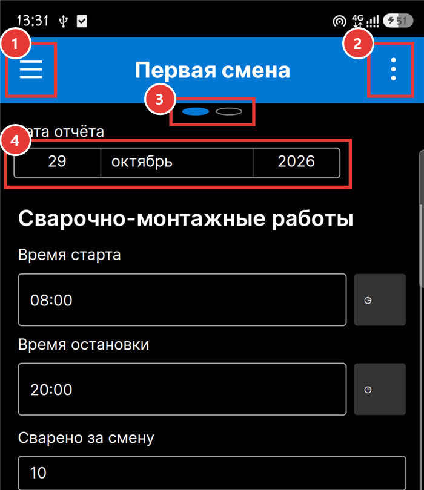

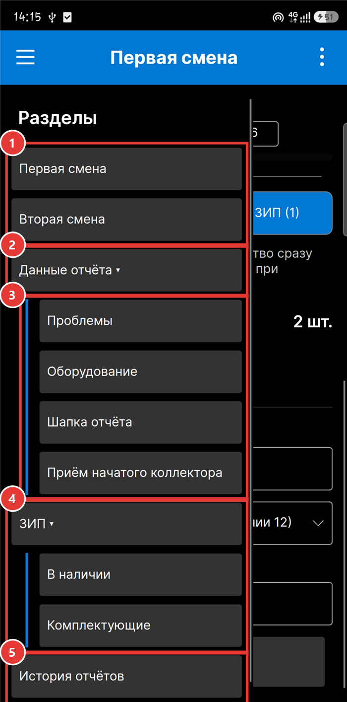

### Дата, сохранение и экспорт
В Windows дата, кнопки «Сохранить» и «Новый отчёт» находятся над вкладками, а экспорт доступен отдельными кнопками и через меню «Файл».

На Android дата находится над прокручиваемой формой отчёта (рисунок 17, цифра 4). Для основных действий нажмите три точки в правом верхнем углу (рисунок 19, цифра 1). Здесь расположены «Сохранить отчёт» (рисунок 19, цифра 2), «Экспортировать Excel» и «Экспортировать PDF» (рисунок 19, цифра 3), «Новый отчёт» (рисунок 19, цифра 4) и «Настройки» (рисунок 19, цифра 5).

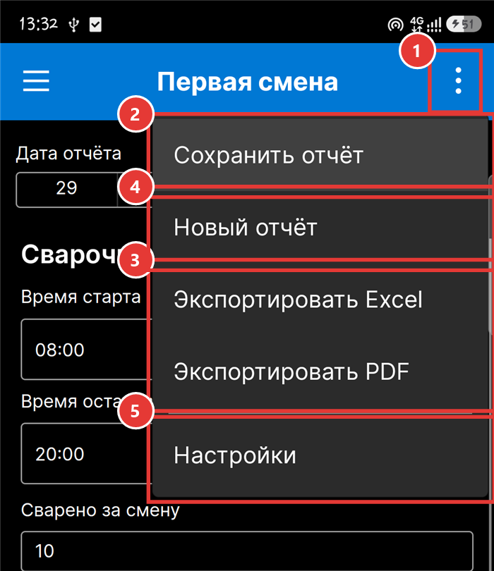

Шапка, оборудование и проблемы на Android сохраняются сами, так же как в Windows. Кнопка «Сохранить начальные данные» находится над формой раздела «Приём начатого коллектора».

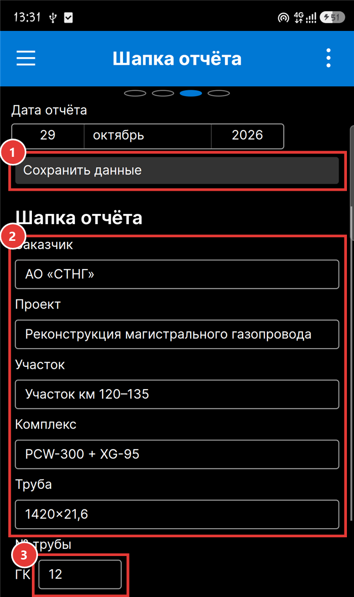

### Заполнение полей и подпись
В Windows поля рассчитаны на работу мышью и клавиатурой; например, техники обеих смен показаны рядом. На Android поля шапки расположены друг под другом: прокручивайте экран вниз, чтобы заполнить всё. Текст вводится с экранной клавиатуры.

В Windows подпись рисуется прямо в шапке мышью или с удержанием Shift при работе с тачпадом. На Android редактор подписи открывается поверх формы, а рисовать нужно пальцем в белом поле (рисунок 21, цифра 1). В нём доступны «Очистить» (рисунок 21, цифра 2), «Сохранить» (рисунок 21, цифра 3) и «Отмена» (рисунок 21, цифра 4).

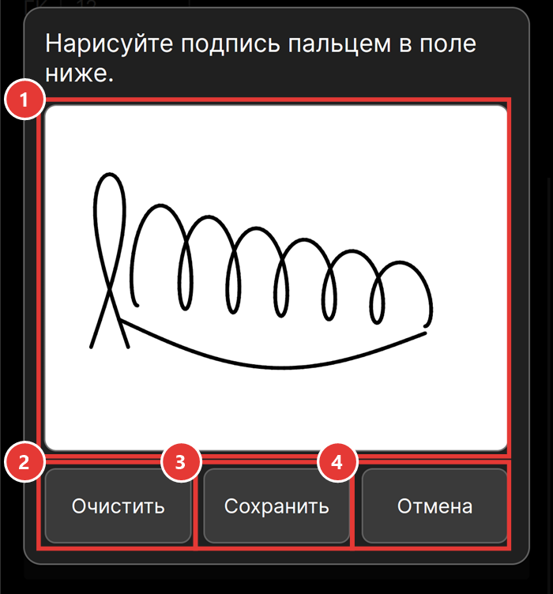

### Расход ЗИП в смене
В Windows комментарии и расход ЗИП — две вкладки под полями смены. На Android под полями смены находится переключатель «Комментарии | Расход ЗИП» (рисунок 22, цифра 1): нажмите нужную половину, чтобы увидеть комментарии или расход. В скобках показано, сколько строк расхода уже добавлено.

Расход добавляется так же, как в Windows: найдите деталь (рисунок 22, цифра 2), выберите её из списка (рисунок 22, цифра 3), введите количество (рисунок 22, цифра 4) и нажмите «Добавить в расход» (рисунок 22, цифра 5).

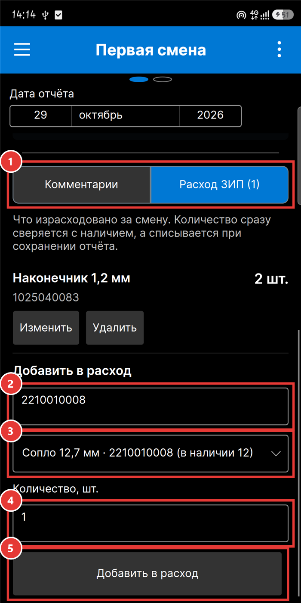

### ЗИП в наличии и справочник
В Windows «В наличии» и «Комплектующие» — вкладки раздела «ЗИП». На Android это два раздела группы «ЗИП» в боковом меню (рисунок 18, цифра 4); между ними можно перелистывать смахиванием.

Вместо таблицы на смартфоне детали показаны карточками: наименование, под ним артикул, справа количество (рисунок 23, цифра 3). Поиск (рисунок 23, цифра 1), кнопка «+ Добавить» (рисунок 23, цифра 2), «Изменить» и «Удалить» (рисунок 23, цифра 4) и «Остатки на дату» (рисунок 23, цифра 5) работают так же, как в Windows. Форма добавления открывается над списком. Текст карточки можно выделить долгим нажатием и скопировать. Раздел «Комплектующие» устроен так же, только без количества.

Системная кнопка или жест «Назад» сначала закрывает открытую форму без сохранения.

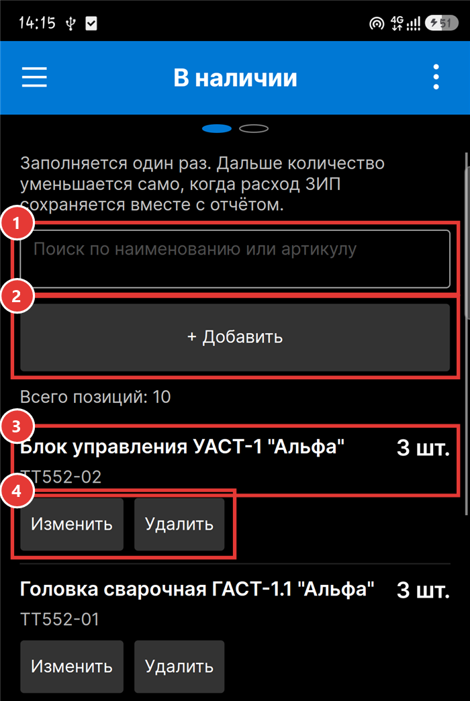

### История и возврат назад
В Windows история открывается кнопкой «История» слева. На Android этот пункт находится в левом боковом меню. Выбор одинаковый: месяц и год → день → отчёт. В открытом отчёте есть кнопки «К дням» (рисунок 24, цифра 1), «Редактировать отчёт» (рисунок 24, цифра 2) и «Удалить отчёт» (рисунок 24, цифра 3).

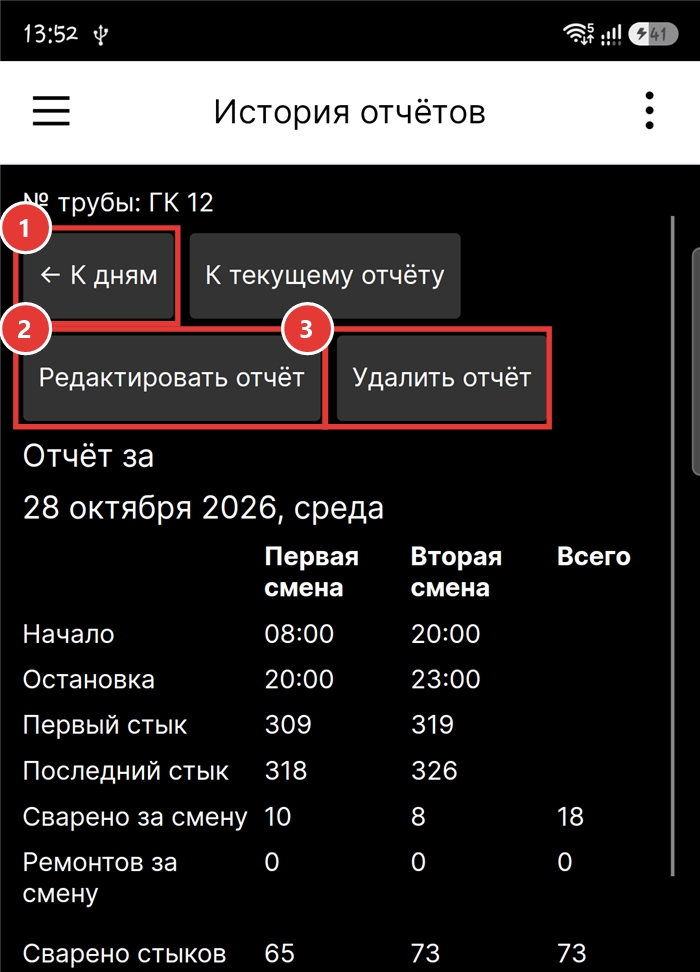

На смартфоне можно пользоваться как кнопками возврата на экране, так и системной кнопкой или жестом «Назад». В истории возврат идёт от отчёта к дням, затем к месяцам. Если открыт редактор подписи, системное действие «Назад» отменяет её редактирование.

При исправлении сохранённого отчёта в Windows нажмите «Отмена» рядом с датой. На Android доступны кнопка «Отмена» под уведомлением о редактировании и пункт «Отменить редактирование» в меню с тремя точками.

### Настройки и выбор папки
В Windows настройки открываются кнопкой «Параметры» слева. На Android нажмите три точки справа вверху и выберите «Настройки».

В Windows путь к папке экспорта можно ввести вручную или выбрать кнопкой «Выбрать папку…». На Android эта кнопка (рисунок 25, цифра 4) открывает системное окно выбора папки: выберите её и подтвердите доступ. На смартфоне также есть кнопка «Вернуть папку по умолчанию» (рисунок 25, цифра 5). Кнопка «Сохранить» (рисунок 25, цифра 6) расположена под ними; при необходимости прокрутите экран. Способ ввода стыков (рисунок 25, цифра 1), тема (рисунок 25, цифра 2), автоматический экспорт (рисунок 25, цифра 3) и «Учёт ЗИП» (рисунок 25, цифра 7) настраиваются так же, как в Windows.

Резервная копия на Android находится дальше на том же экране, его нужно прокрутить: отметьте разделы (рисунок 26, цифра 1) и нажмите «Экспорт данных» (рисунок 26, цифра 2) или «Импорт данных» (рисунок 26, цифра 3).

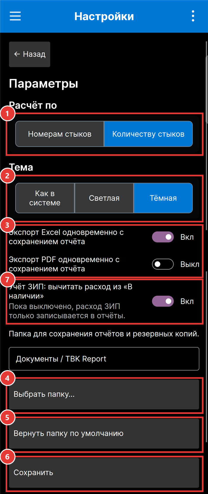

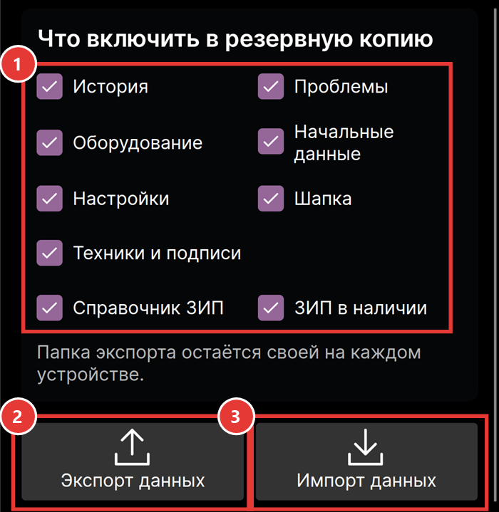

---

## 14. Обновление программы
Когда выйдет новая версия, ответственный за программу пришлёт ссылку на установщик для Windows и файл APK для Android. Новая версия ставится поверх старой: история, шапка, оборудование, проблемы, ЗИП и настройки сохраняются.

### Перед обновлением
Сделайте резервную копию, как описано в [разделе 12](#12-резервные-копии-и-передача-данных-другому-технику): откройте «Параметры», отметьте все разделы (рисунок 16, цифра 1) и нажмите «Экспорт данных» (рисунок 16, цифра 2). Если при обновлении что-то пойдёт не так, данные можно будет вернуть через «Импорт данных».

### Windows
1. Закройте «ТБК Отчёт».
2. Скачайте установщик новой версии и запустите его. Windows может показать те же предупреждения, что и при первой установке.
3. На вопрос «Разрешить этому приложению вносить изменения?» ответьте «Да».
4. Появится окно «Всё готово к установке». Папку выбирать не нужно: установщик сам нашёл прежнюю установку. Нажмите «Установить» (рисунок 27, цифра 1).
5. Когда окно закроется, откройте программу и проверьте историю, шапку и настройки.

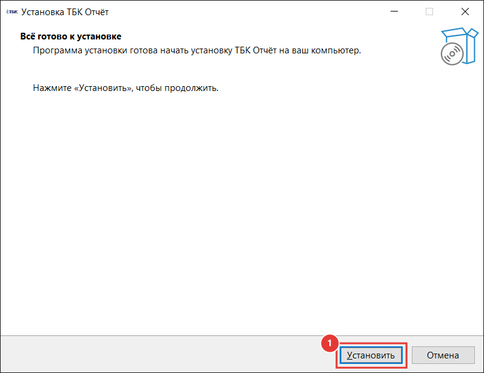

### Android
1. Не удаляйте старую версию перед обновлением: удаление приложения стирает его историю и настройки.
2. Скачайте APK новой версии и откройте его.
3. Android спросит «Обновить приложение?». Нажмите «Обновить» (рисунок 28, цифра 1).
4. Откройте программу и проверьте историю, шапку и настройки.

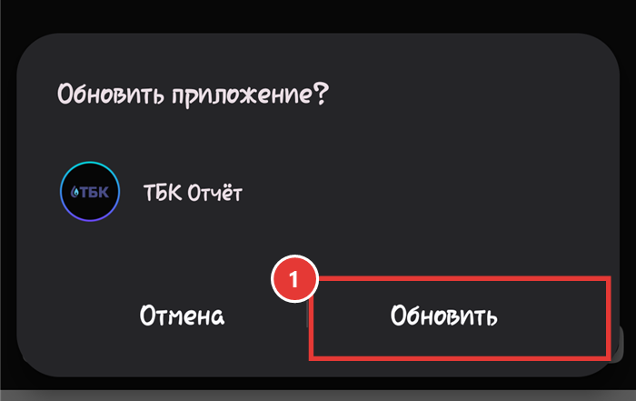

Если Android пишет, что приложение не установлено или подпись не совпадает, не удаляйте старую версию: сначала сделайте резервную копию и сообщите ответственному за программу.
