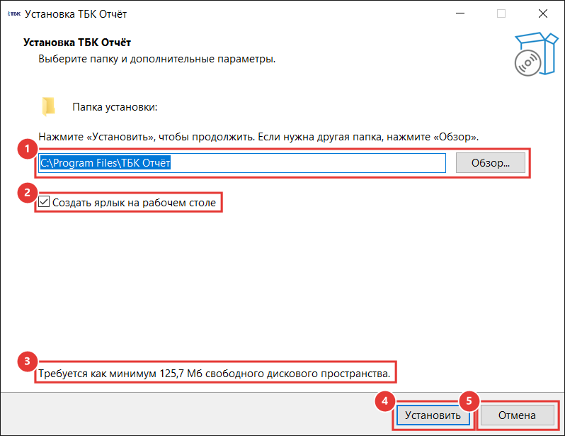
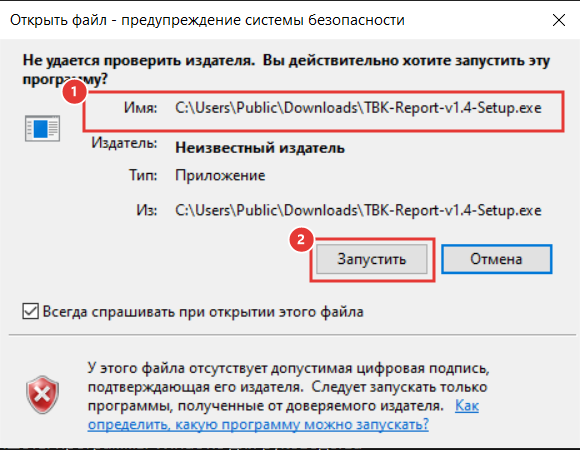
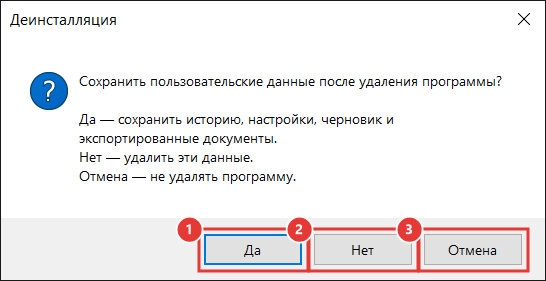
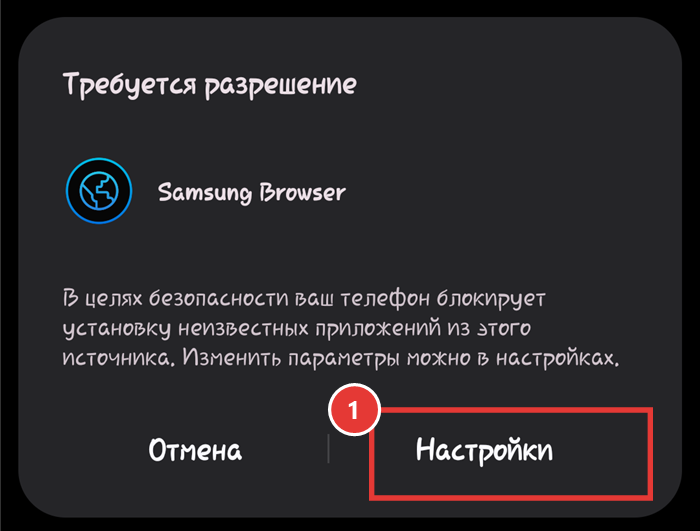
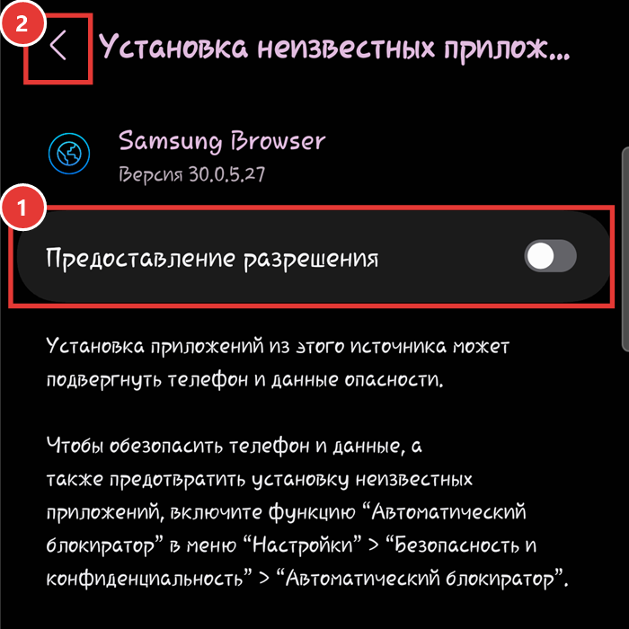
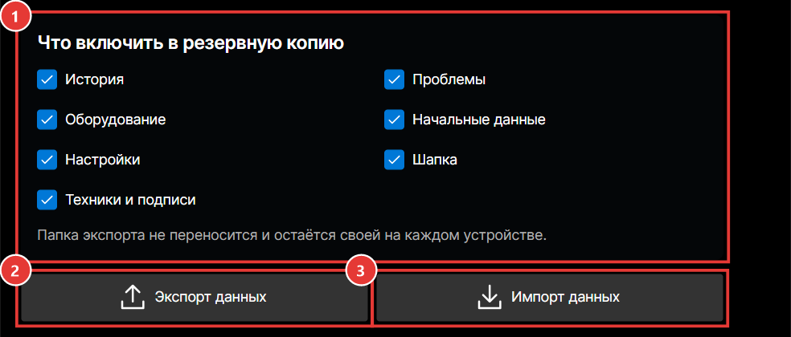

# ТБК Отчёт
## Руководство по установке · Windows и Android

## Содержание
1. Перед установкой
2. Установка версии для Windows
3. Предупреждение Windows при запуске установщика
4. Обновление версии для Windows
5. Удаление версии для Windows
6. Установка версии для Android
7. Разрешение установки из неизвестного источника
8. Предупреждения Google Play Защиты
9. Обновление версии для Android
10. Удаление версии для Android
11. Сохранность отчётов и резервная копия

---

## 1. Перед установкой
Получайте установочные файлы только по ссылке, которую передал ответственный за программу. Не устанавливайте файлы, присланные неизвестным человеком или скачанные с постороннего сайта.

Для Windows используется файл «TBK-Report-v1.4-Setup.exe». Для Android используется файл с расширением APK. Название APK может содержать название программы, версию и слово Signed.

Windows-версия предназначена для 64-разрядной Windows. Android-версия предназначена для устройств с Android 6.0 и новее и 64-разрядным ARM-процессором.

Перед обновлением программы рекомендуется создать резервную копию данных в разделе «Параметры» → «Экспорт данных». Это особенно важно перед переустановкой, удалением приложения или переносом на другое устройство.

---

## 2. Установка версии для Windows
1. Скачайте установщик «TBK-Report-v1.4-Setup.exe».
2. Откройте папку «Загрузки» и дважды щёлкните по установщику.
3. Если Windows покажет предупреждение системы безопасности, выполните действия из следующего раздела.
4. Появится окно «Разрешить этому приложению вносить изменения на вашем устройстве?». Нажмите «Да». Без этого установка невозможна: программа ставится в общую папку «Program Files».
5. Откроется окно «Установка ТБК Отчёт». Это единственное окно с настройками, его поля описаны ниже.
6. Нажмите «Установить» и дождитесь, пока заполнится полоса прогресса. Обычно это занимает меньше минуты.
7. Когда установка закончится, окно закроется само. Программа не запускается автоматически: откройте её ярлыком «ТБК Отчёт» на рабочем столе или через меню «Пуск».

### Окно «Установка ТБК Отчёт»
Вверху окна написано «Выберите папку и дополнительные параметры». Цифры в списке соответствуют рамкам на рисунке.

1. «Папка установки» — куда будет установлена программа. По умолчанию: «C:\Program Files\ТБК Отчёт». Назначьте свою папку при необходимости: нажмите «Обзор…» и выберите пустую папку или папку, где программа уже установлена. Если в выбранной папке лежат посторонние файлы, установщик сообщит «В выбранной папке уже есть посторонние файлы» и не продолжит — выберите другую папку.
2. «Создать ярлык на рабочем столе» — флажок включён. Оставьте его включённым, если хотите запускать программу с рабочего стола. Если флажок снять, программа всё равно появится в меню «Пуск».
3. Строка о свободном месте — сколько места нужно на диске, около 130 МБ.
4. «Установить» — начинает установку с выбранными параметрами.
5. «Отмена» — закрывает установщик, ничего не устанавливая.

Отдельно устанавливать .NET или другие компоненты не нужно: всё необходимое входит в установщик. Данные программы (история, настройки, черновик) хранятся не в папке установки, а в профиле пользователя Windows, поэтому выбор папки установки на них не влияет.

## 3. Предупреждение Windows при запуске установщика
Установщик пока не подписан сертификатом, которому доверяет Windows. Поэтому при первом запуске могут появиться сообщения «Windows защитила ваш компьютер», «Неизвестный издатель» или предупреждение браузера о редко скачиваемом файле. Само наличие такого сообщения не означает, что в файле найден вирус: Windows также предупреждает о новых и неподписанных программах.

Продолжайте установку только в том случае, если файл получен по официальной ссылке проекта и его название соответствует инструкции.

Если появилось окно Microsoft Defender SmartScreen «Windows защитила ваш компьютер»:
1. Нажмите «Подробнее».
2. Убедитесь, что запускается установщик «TBK-Report-v1.4-Setup.exe».
3. Нажмите «Выполнить в любом случае».

Если появилось окно «Открыть файл — предупреждение системы безопасности» или «Неизвестный издатель», проверьте имя файла и нажмите «Запустить». Затем подтвердите запрос контроля учётных записей кнопкой «Да».

Если антивирус сообщает именно об обнаруженной угрозе, а не просто о неизвестном издателе или низкой репутации файла, не отключайте защиту. Отмените запуск и сообщите ответственному за программу, приложив текст или снимок предупреждения.

## 4. Обновление версии для Windows
1. Закройте «ТБК Отчёт».
2. На всякий случай создайте резервную копию через «Экспорт данных».
3. Скачайте установщик новой версии.
4. Запустите его и нажмите «Да» в окне контроля учётных записей. Окно с выбором папки при обновлении не показывается: установщик сам находит прежнюю папку и сразу начинает установку. Ярлык на рабочем столе создаётся заново.
5. После установки откройте программу и проверьте историю, шапку и настройки.

Установщик распознаёт прежнюю установку по постоянному идентификатору программы и заменяет поставляемые файлы новой версией. История, настройки, черновик и созданные пользователем отчёты не входят в состав установщика, поэтому обычное обновление их не удаляет.

Важно: обновление не выполняет полную очистку папки установки. Если в старой версии находился файл, которого больше нет в составе новой версии, он может остаться. Это не затрагивает обычную установку текущей версии, но означает, что установщик не «подтирает всё» перед обновлением.

## 5. Удаление версии для Windows
Откройте «Параметры Windows» → «Приложения» → «Установленные приложения», найдите «ТБК Отчёт» и нажмите «Удалить». Подтвердите запрос контроля учётных записей кнопкой «Да».

Перед удалением появится вопрос «Сохранить пользовательские данные после удаления программы?» с тремя кнопками:

- «Да» — удалить только программу. История, настройки, черновик и экспортированные документы Excel и PDF останутся; при повторной установке программа их подхватит. Выбирайте этот вариант, если не уверены.
- «Нет» — удалить программу вместе с историей, настройками, черновиком и папкой «Документы\ТБК Отчёт» с экспортированными отчётами. Восстановить их после этого можно только из резервной копии.
- «Отмена» — ничего не удалять.

Перед вариантом «Нет» обязательно сделайте резервную копию через «Параметры» → «Экспорт данных» и перенесите файл «TBK Backup.tbkdata» в другое место: если папка экспорта не менялась, файл лежит в «Документы\ТБК Отчёт» и будет удалён вместе с ней.

---

## 6. Установка версии для Android
1. Скачайте APK по официальной ссылке на смартфон.
2. Откройте загруженный файл через уведомление, папку «Загрузки» или приложение «Файлы».
3. Если Android запретит установку из этого источника, разрешите её по инструкции из следующего раздела.
4. Вернитесь к APK и снова нажмите «Установить».
5. Дождитесь завершения и нажмите «Открыть».
6. При первом запуске откройте «Настройки» программы и проверьте папку для Excel, PDF и резервных копий.

Названия кнопок и разделов системных настроек немного различаются у Samsung, Xiaomi, Honor, Realme и других производителей. Принцип одинаковый: разрешение выдаётся тому приложению, через которое открыт APK.

## 7. Разрешение установки из неизвестного источника
Android называет источник неизвестным, потому что APK установлен не из Google Play. Разрешение выдаётся отдельно браузеру, мессенджеру или файловому менеджеру, из которого запускается файл.

Обычно после открытия APK появляется сообщение «В целях безопасности телефон блокирует установку приложений из неизвестных источников». Нажмите «Настройки» и включите переключатель: на Samsung он называется «Предоставление разрешения», на других смартфонах — «Разрешить установку из этого источника», «Разрешить из этого источника» или «Неизвестные источники». Затем вернитесь назад и повторите установку.

Если кнопки перехода в настройки нет, откройте системные «Настройки» → «Приложения» → «Специальный доступ» → «Установка неизвестных приложений». Выберите браузер или приложение «Файлы», через которое открыт APK, и включите разрешение.

После установки рекомендуется снова отключить это разрешение для выбранного браузера или файлового менеджера. Для работы уже установленной программы оно не требуется.

На смартфоне с включённой усиленной защитой, рабочим профилем или ограничениями организации установка сторонних APK может быть полностью запрещена. В этом случае не отключайте корпоративные ограничения самостоятельно — обратитесь к администратору устройства.

## 8. Предупреждения Google Play Защиты
Google Play Защита проверяет приложения, в том числе установленные не из магазина. Для нового APK могут появиться сообщения «Неизвестное приложение», «Отправить приложение на проверку», «Приложение не распознано» или предложение проверить файл.

Если предлагается проверка, разрешите её и дождитесь результата. Если после проверки Android сообщает, что угрозы не обнаружены, продолжите установку.

Предупреждение о том, что разработчик или приложение неизвестны Google Play, возможно потому, что программа распространяется напрямую и не опубликована в магазине. Убедитесь, что APK получен по официальной ссылке проекта, после чего используйте доступную на вашем устройстве команду продолжения установки, например «Подробнее» → «Всё равно установить».

Не путайте предупреждение о неизвестном источнике с сообщением об обнаруженном вредоносном приложении. Если Google Play Защита прямо сообщает, что приложение вредоносное, блокирует его как опасное или автоматически удаляет, не отключайте Play Защиту. Остановите установку и передайте ответственному точный текст или снимок предупреждения.

У программы есть постоянная цифровая подпись Android. Благодаря этому следующая версия, подписанная тем же ключом, устанавливается как обновление поверх предыдущей. При установке файла с другой подписью Android потребует удалить старое приложение; до удаления обязательно создайте резервную копию.

## 9. Обновление версии для Android
1. Откройте текущую программу и создайте резервную копию через «Параметры» → «Экспорт данных».
2. Скачайте новый APK из официального источника.
3. Откройте APK и нажмите «Обновить» или «Установить».
4. Если потребуется, снова разрешите установку из источника, через который открыт файл.
5. После завершения откройте программу и проверьте историю и настройки.

При обычном обновлении поверх установленной версии данные приложения сохраняются. Не удаляйте старую программу перед обновлением: удаление приложения может удалить его внутренние данные.

Если Android пишет, что приложение не установлено или подпись пакета не совпадает, не удаляйте старую версию сразу. Сначала создайте и вынесите резервную копию, затем уточните у ответственного, получен ли правильный APK.

## 10. Удаление версии для Android
Нажмите и удерживайте значок «ТБК Отчёт» и выберите «О приложении» → «Удалить» либо откройте системные «Настройки» → «Приложения» → «ТБК Отчёт» → «Удалить».

При удалении Android очищает данные приложения. Файлы Excel, PDF и резервные копии, сохранённые в выбранной общей папке документов, обычно остаются, но история и настройки внутри данных приложения могут быть потеряны. Перед удалением обязательно выполните «Экспорт данных» и убедитесь, что файл резервной копии появился в выбранной папке.

## 11. Сохранность отчётов и резервная копия
Обычное обновление Windows или Android рассчитано на сохранение истории и настроек. Однако перед любым обновлением, переустановкой или удалением безопаснее создать резервную копию.

В программе откройте «Параметры», отметьте необходимые разделы и нажмите «Экспорт данных». Для полной передачи работы на другое устройство выберите историю, проблемы, оборудование, начальные данные, настройки, шапку, техников и подписи.

Проверьте, что файл «TBK Backup.tbkdata» действительно появился в папке экспорта. Храните копию отдельно от папки программы и устройства, которое собираетесь переустанавливать.

После установки на другом устройстве откройте «Параметры» → «Импорт данных», выберите резервную копию и подтвердите импорт. Затем перезапустите программу и проверьте номер ГК, историю, начальные данные, оборудование и проблемы.
