# ТБК Отчёт
## Руководство пользователя · версия 1.4 · Windows

## Содержание
- Возможности программы
1. Вы приехали на трассу и принимаете смену
2. Заполните шапку отчёта
3. Проверьте и внесите оборудование
4. Уточните проблемные вопросы
5. Подготовьте нумерацию: новый или уже начатый коллектор
6. Заполняйте отчёт по ходу работы
7. Сохраните и отправьте отчёт
8. Закончили старый коллектор и начинаете новый
9. История: найти, исправить или повторно выгрузить отчёт
10. Настройки
11. Резервные копии и передача данных другому технику
12. Чем отличается интерфейс Windows и Android

---

## Возможности программы
Программа предназначена для подготовки ежедневных отчётов о сварочно-монтажных работах. Она объединяет сведения о двух сменах, считает сваренные стыки и ремонты, сохраняет историю и экспортирует отчёты в Excel и PDF.

Возможности программы:
- Ведение первой и второй смены: время работы, номера и количество стыков, ремонты, комментарии.
- Расчёт количества по номерам стыков или определение номеров по введённому количеству.
- Учёт нарастающих итогов за месяц и продолжение нумерации по ГК.
- Заполнение шапки отчёта, списка техников и их рукописных подписей.
- Ведение оборудования и проблемных вопросов.
- Просмотр, исправление и удаление сохранённых отчётов.
- Ручной и автоматический экспорт в Excel и PDF.
- Восстановление незавершённой работы и перенос данных через резервную копию.

## 1. Вы приехали на трассу и принимаете смену
Перед первым отчётом уточните у техника, которого меняете, состояние работ. Эти сведения понадобятся при заполнении программы:
- На каком объекте и комплексе ведутся работы, какая труба используется и какой номер у текущего ГК.
- Кто работает техником в каждой смене.
- Какое оборудование есть на участке, сколько единиц находится в работе и сколько в резерве.
- Какие проблемы остаются нерешёнными и что необходимо отразить в отчёте.
- Начинается ли сварка коллектора с нуля или часть стыков уже сварена. Если работы идут, узнайте последний номер стыка, количество сваренных стыков и ремонтов за текущий месяц.

Запустите программу и проверьте «Дату отчёта». Затем откройте «Данные отчёта». Сначала заполните шапку, оборудование и проблемы, а после этого подготовьте данные для нумерации стыков.

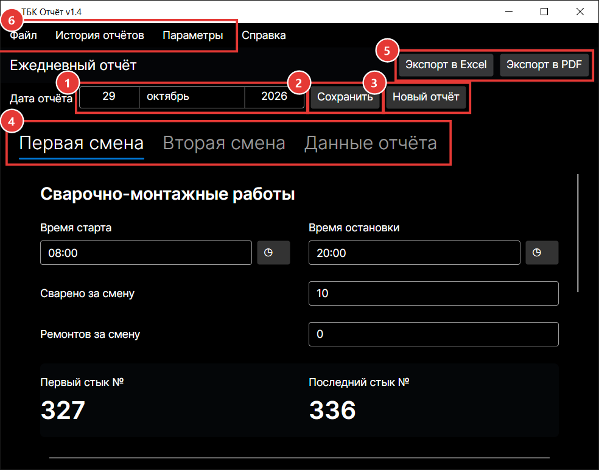

---

## 2. Заполните шапку отчёта
Откройте «Данные отчёта» → «Шапка отчёта». Внесите сведения, полученные при приёме смены:
- «Заказчик» — наименование заказчика.
- «Проект» — название проекта.
- «Участок» — участок, на котором выполняются работы.
- «Комплекс» — обозначение вашего комплекса.
- «Труба» — параметры используемой трубы.
- «№ трубы ГК» — номер коллектора, на котором вы работаете.

Номер ГК особенно важен: по нему программа продолжает нумерацию стыков и рассчитывает месячные показатели. Проверьте номер перед началом заполнения смен.

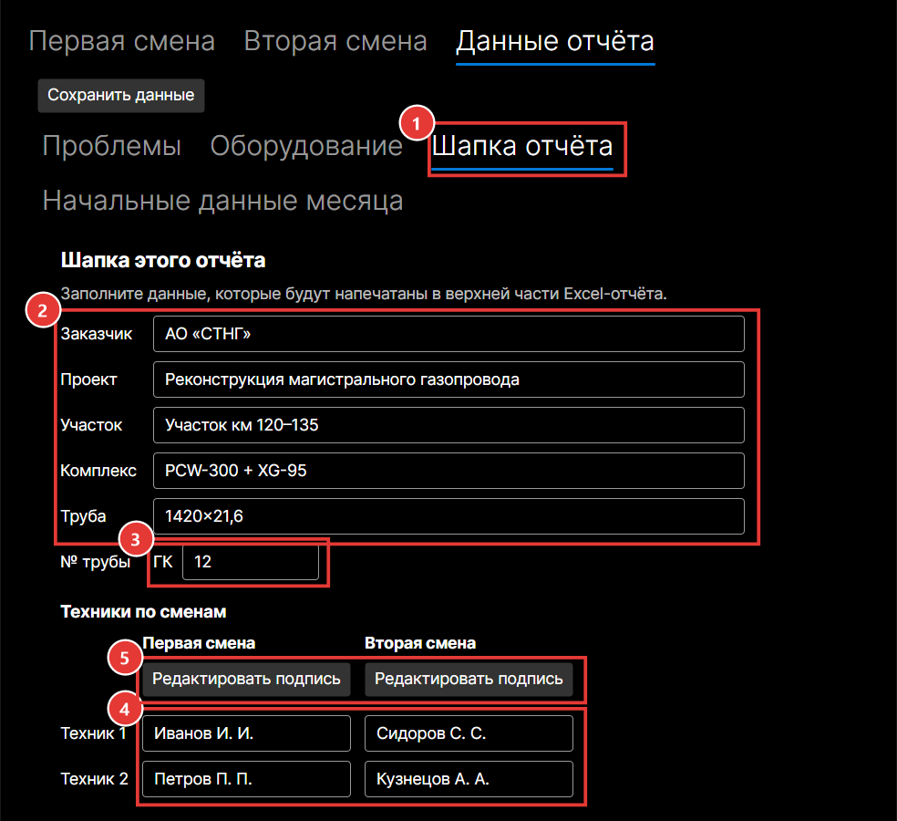

### Укажите техников и добавьте подписи
Заполните фамилии и инициалы техников первой и второй смен. Для каждой смены предусмотрено до двух техников.

После заполнения поля «Техник 1» появляется кнопка добавления подписи. Нажмите её и нарисуйте подпись, удерживая левую кнопку мыши. При работе с тачпадом можно удерживать Shift и перемещать указатель.

В редакторе подписи «Очистить» позволяет нарисовать её заново, «Сохранить» принимает результат, а «Отмена» возвращает прежнюю подпись. Подпись будет включена в Excel и PDF. Если удалить имя первого техника, его подпись тоже удалится.

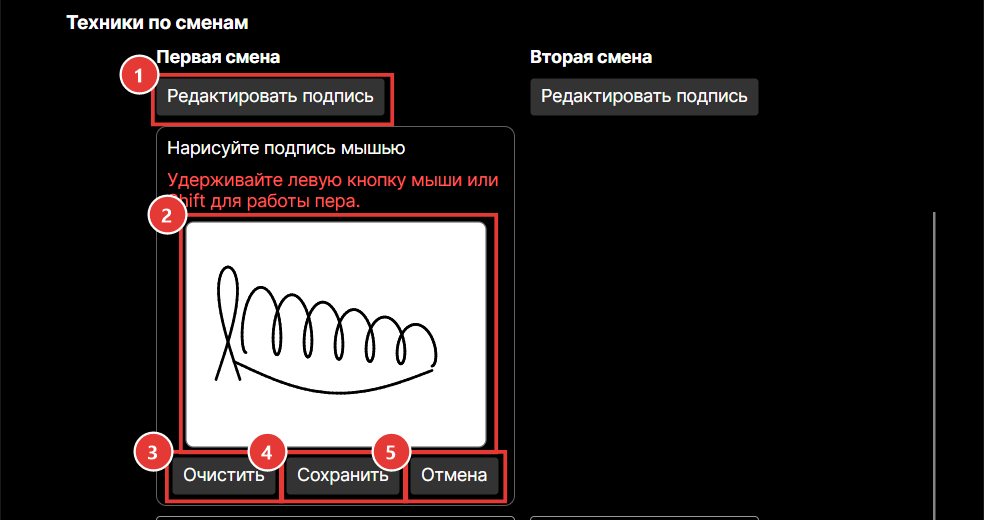

## 3. Проверьте и внесите оборудование
Откройте «Данные отчёта» → «Оборудование». Сверьте список с техником, которого меняете, и внесите фактическое количество оборудования.

Обозначения в программе и отчёте:
- «Рб» — в работе: сколько единиц оборудования задействовано в работе.
- «Рз» — в резерве: сколько единиц оборудования находится в резерве.

Например, если два аппарата используются, а один находится в резерве, укажите для этого оборудования «Рб: 2» и «Рз: 1». Если резерва нет, укажите 0.

Для каждой позиции заполните название и оба количества, затем добавьте её в список. Кнопками «Изменить» и «Удалить» можно исправить сведения. Количества вводятся целыми неотрицательными числами.

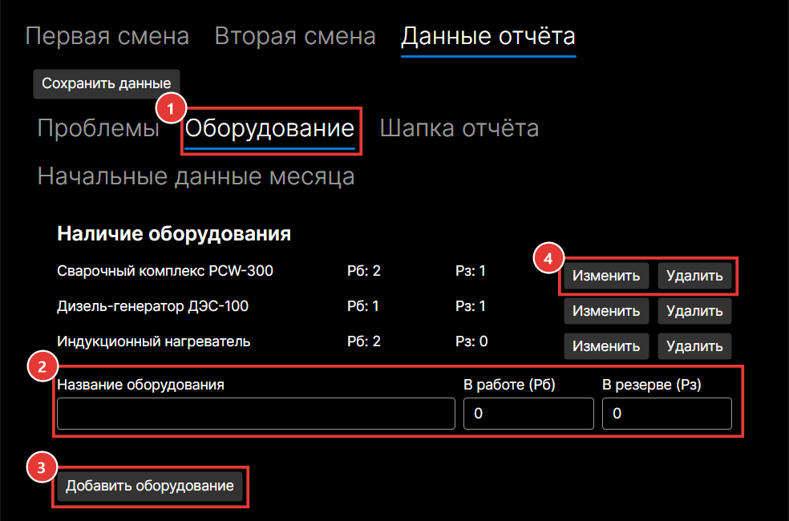

## 4. Уточните проблемные вопросы
Откройте «Данные отчёта» → «Проблемы». Уточните у сменяемого техника, какие вопросы ещё не решены: например, неисправности оборудования, нехватка расходных материалов или ожидаемые поставки. Внесите актуальные проблемы отдельными пунктами.

В этом разделе время не указывается. События конкретной смены с привязкой ко времени добавляются позднее в комментарии смены. Проблемы можно изменять и удалять; программа сама обновляет их нумерацию.

После заполнения шапки, оборудования и проблем нажмите «Сохранить данные». Эти сведения будут доступны при следующих запусках. В дальнейшем обновляйте их при изменении состава техников, оборудования или текущих проблем.

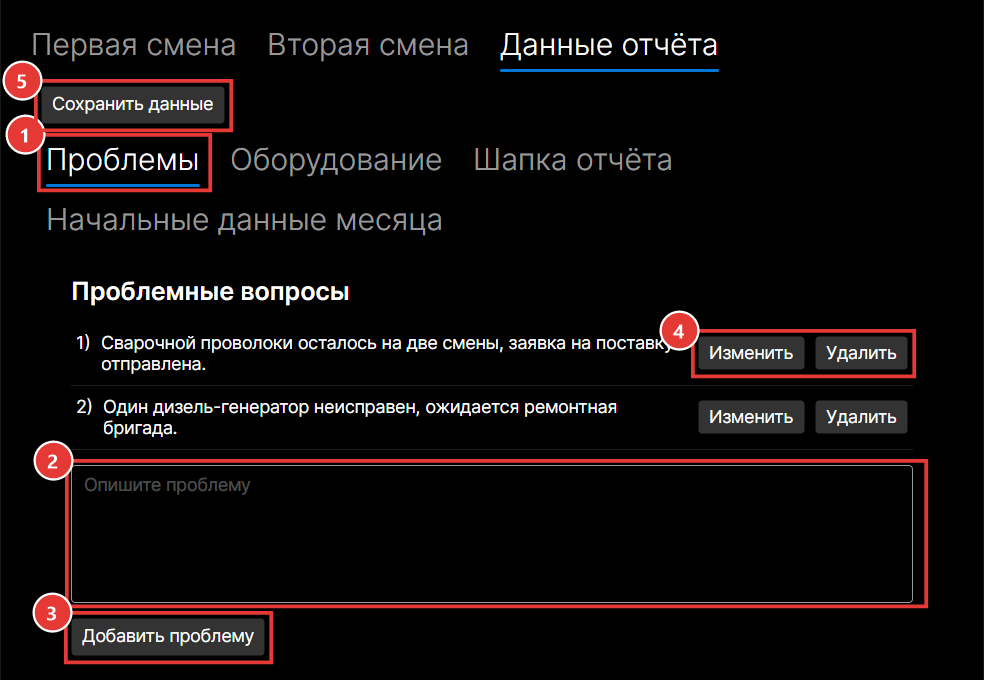

---

## 5. Подготовьте нумерацию: новый или уже начатый коллектор
Перед первым отчётом определите, с какого состояния вы начинаете работу в программе.

### Коллектор начинают варить с нуля
Укажите его номер ГК в шапке. Если для этого номера ещё нет отчётов и начальных данных, программа начнёт нумерацию с первого стыка. Начальные данные заполнять не нужно — можно переходить к заполнению смен.

Первый номер подставляется после ввода времени старта смены. Если в первой смене сварки не было, работу можно начать со второй.

### Коллектор уже начали варить
Если предыдущие работы ещё не внесены в историю программы, обязательно заполните начальные данные до первого отчёта. Иначе программа не сможет правильно продолжить нумерацию и учесть ранее выполненные работы в месячном итоге.

Уточните значения у техника, которого меняете, и сверьте их с предыдущим отчётом. Затем:
1. Проверьте месяц в дате отчёта и номер ГК в шапке.
2. Откройте «Данные отчёта» → «Начальные данные месяца».
3. В поле «Последний номер стыка» внесите номер последнего уже сваренного стыка этого коллектора.
4. В поле «Сварено стыков за месяц» внесите количество, уже сваренное в текущем месяце до начала ваших отчётов.
5. В поле «Ремонтов за месяц» внесите накопленное количество ремонтов за текущий месяц. Если ремонтов не было, укажите 0.
6. Нажмите «Сохранить начальные данные».

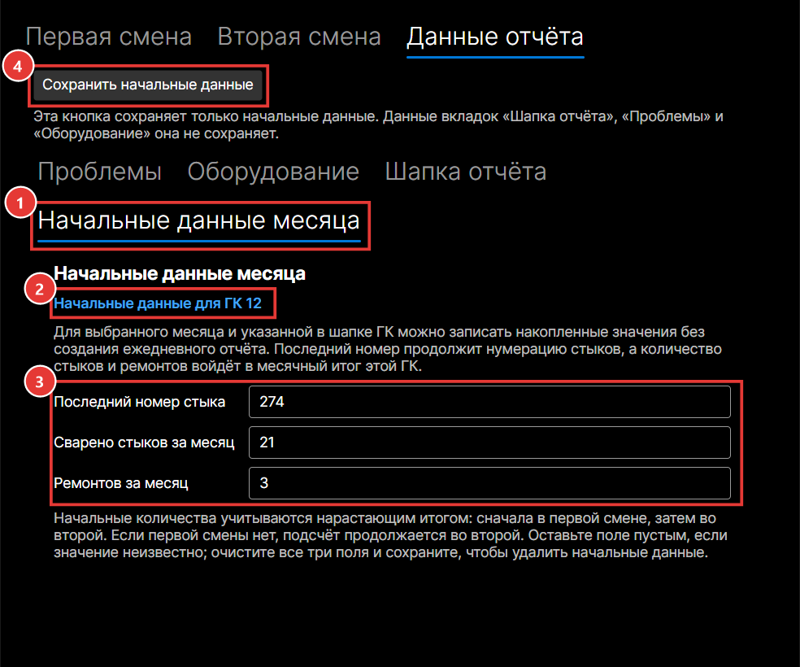

Например: последний сваренный стык — 274, за текущий месяц сварен 21 стык и выполнено 3 ремонта. Введите соответственно 274, 21 и 3. Следующим будет стык 275, а месячные количества продолжатся от 21 стыка и 3 ремонтов.

Последний номер стыка и количество за месяц — разные значения. Если коллектор начали в прошлом месяце, в месячное количество не нужно включать все стыки с начала его сварки.

Если предыдущие отчёты уже есть в истории программы, повторно включать эти работы в начальные данные не нужно: они будут учтены дважды. При приёме готовой истории проверьте её полноту и уже внесённые начальные данные.

### Если в начальных данных допущена ошибка
Чтобы заменить сохранённые значения, очистите все три поля и нажмите «Сохранить начальные данные». После этого внесите правильные значения и сохраните их снова. Перед изменением проверьте выбранные месяц и ГК.

---

## 6. Заполняйте отчёт по ходу работы
Откройте «Первую смену» или «Вторую смену» — ту, за которую вносите сведения. Проверьте дату: именно за неё будет сохранён отчёт.

### Начало и окончание сварки
Укажите «Время старта». Программа предложит первый номер стыка с учётом выбранного ГК, начальных данных и предыдущих отчётов. В конце работ укажите «Время остановки» и последний сваренный стык.

В обычном режиме количество считается по первому и последнему номерам включительно. Например, стыки с 275 по 284 — это 10 стыков. Второй смене программа предложит продолжить нумерацию со стыка 285.

В поле «Ремонтов за смену» укажите количество ремонтов. Если их не было, введите 0. Пустое поле означает, что сведения не указаны, и отображается прочерком.

Можно работать и по количеству стыков: в этом режиме вы вводите число сваренных стыков, а программа рассчитывает первый и последний номера. Переключение режима описано в разделе «Настройки».

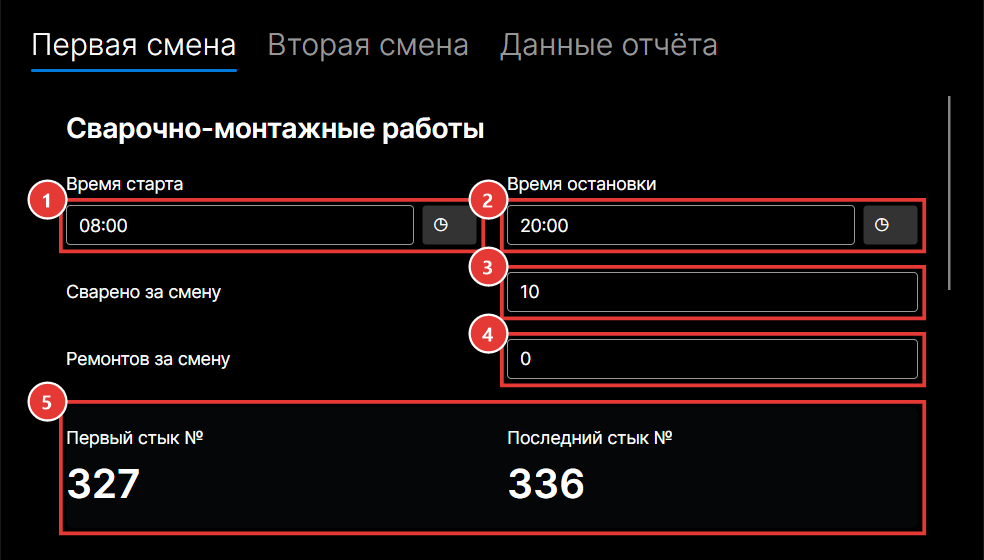

### Записывайте события смены
В блоке «Комментарии смены» укажите время и текст события. Если событие длилось какое-то время, включите «Диапазон времени» и заполните начало и конец. Например: «10:00–11:30 — ожидание подачи трубы». Добавьте комментарий кнопкой под текстом.

Программа расставляет записи по времени начала. Комментарии можно изменять и удалять. При вводе времени старта и остановки автоматически появляются записи «Старт СМР» и «Стоп СМР». При изменении времени эти записи обновляются.

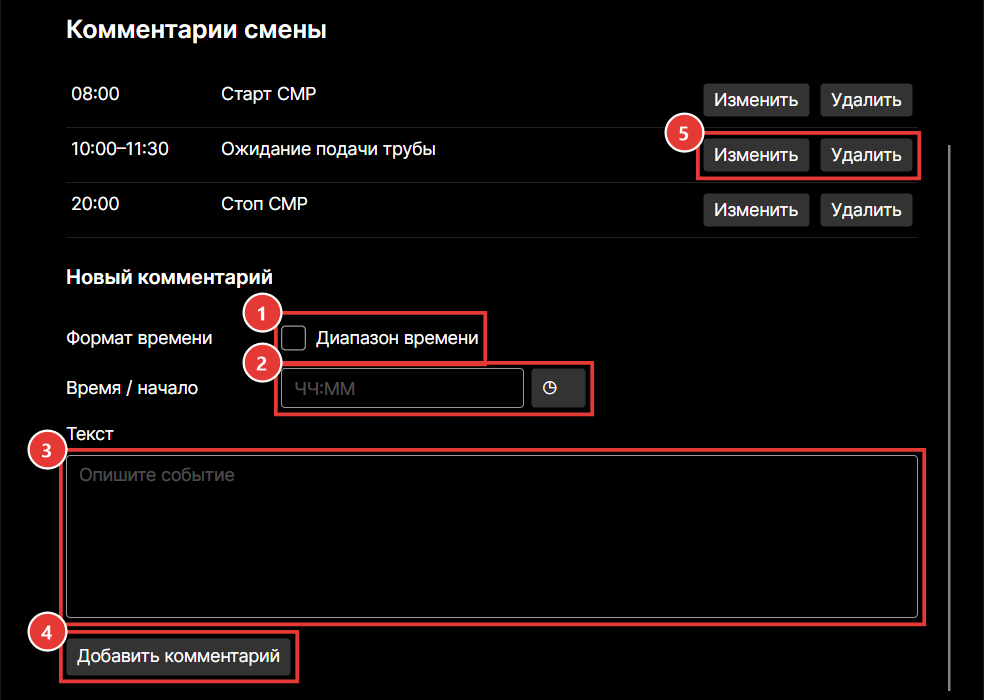

### Если сварки не было
Добавьте комментарий со временем и причиной, например: «08:00–20:00 — отсутствие фронта работ». Не вводите вымышленные номера стыков или время старта сварки.

Отчёт без сварки можно сохранить и экспортировать, если добавлен хотя бы один комментарий со временем. Если время старта указано, для этой смены нужно заполнить время остановки и корректные данные стыков. Пропущенные обязательные поля программа подсветит.

### Если пришлось закрыть программу
Незавершённые поля смен и комментарии автоматически сохраняются в черновик и восстанавливаются при следующем запуске. Шапку, оборудование и проблемы сохраняйте отдельно кнопкой «Сохранить данные».

---

## 7. Сохраните и отправьте отчёт
После заполнения смен проверьте дату, номер ГК, номера стыков, ремонты и комментарии. При необходимости обновите оборудование и проблемные вопросы.

Нажмите «Сохранить» рядом с датой. Это добавит отчёт в историю вместе с его шапкой, подписями, оборудованием и проблемами.

Затем нажмите «Экспорт в Excel» или «Экспорт в PDF» и передайте полученный файл коллегам. Эти же команды доступны в меню «Файл». Если одноимённый файл уже существует, при ручном экспорте программа предложит заменить его.

«Сохранить данные» запоминает сведения для дальнейшей работы, «Сохранить» рядом с датой фиксирует ежедневный отчёт в истории, а «Экспорт» создаёт файл для отправки. Сам по себе экспорт не добавляет отчёт в историю.

Программа ведёт один отчёт на дату. Повторное сохранение за ту же дату обновляет эту запись.

### Как читать месячные итоги
Месячные показатели учитывают начальные данные и отчёты по выбранной ГК с начала месяца по дату отчёта. В первой и второй сменах показан нарастающий итог.

Например, ранее в месяце было сварено 100 стыков, первая смена добавила 10, а вторая — 8. В месячных показателях будет 110 после первой смены, 118 после второй и 118 в графе «Всего». Складывать 110 и 118 не нужно.

### Следующий день
После сохранения завершённого отчёта нажмите «Новый отчёт» и проверьте дату следующего отчёта. Если остались несохранённые изменения, программа запросит подтверждение их удаления.

Для того же ГК нумерация продолжится по истории, в том числе при переходе на новый месяц. Начальные данные не нужно заново вводить каждый день или переносить в них итог предыдущего месяца.

## 8. Закончили старый коллектор и начинаете новый
1. Сохраните отчёт по завершённому коллектору и выгрузите его при необходимости.
2. Подготовьте новый отчёт и откройте «Данные отчёта» → «Шапка отчёта».
3. Измените «№ трубы ГК» на номер нового коллектора и нажмите «Сохранить данные».
4. Переходите к заполнению смен по новому коллектору.

Если новый ГК ещё не имеет отчётов и начальных данных, программа начнёт счёт заново — с первого стыка. Работы старого ГК не будут прибавляться к показателям нового.

Если выбранный ГК уже варили и его данные есть в программе, нумерация продолжится по ним. Если его начали варить, но этих работ в программе ещё нет, сначала заполните начальные данные, как описано в разделе 5.

Меняйте номер ГК перед вводом новых смен: при смене номера программа пересчитывает диапазоны, сохраняя введённое количество. Кнопка «Новый отчёт» сама по себе не меняет номер ГК.

Если переход между коллекторами произошёл в один день, учитывайте ограничение текущей версии: сохранить два отдельных отчёта за одну дату нельзя.

---

## 9. История: найти, исправить или повторно выгрузить отчёт
Откройте «История отчётов», выберите месяц и год, затем день. Здесь можно посмотреть смены, дневные и месячные показатели, комментарии, оборудование и проблемы.

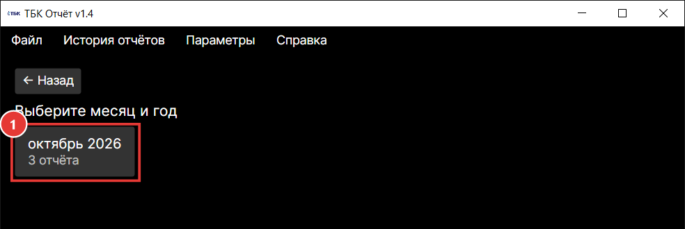

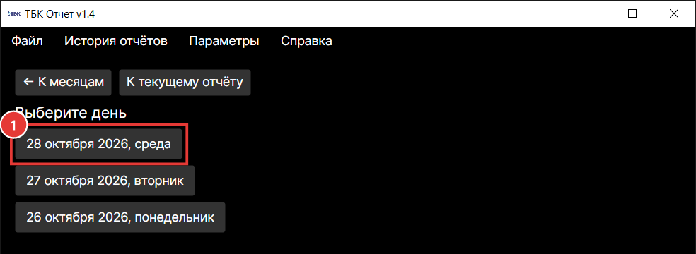

Чтобы исправить запись, нажмите «Редактировать отчёт», внесите изменения и нажмите «Сохранить». Дата при редактировании заблокирована. Кнопка «Отмена» вернёт вас к обычному черновику без изменения сохранённого отчёта.

Чтобы повторно получить Excel или PDF, откройте нужный день истории и выберите экспорт в меню «Файл». Будет выгружен именно открытый сохранённый отчёт.

«Удалить отчёт» удаляет выбранную запись после подтверждения. Месячные итоги пересчитываются. Уже выгруженные Excel и PDF при этом остаются.

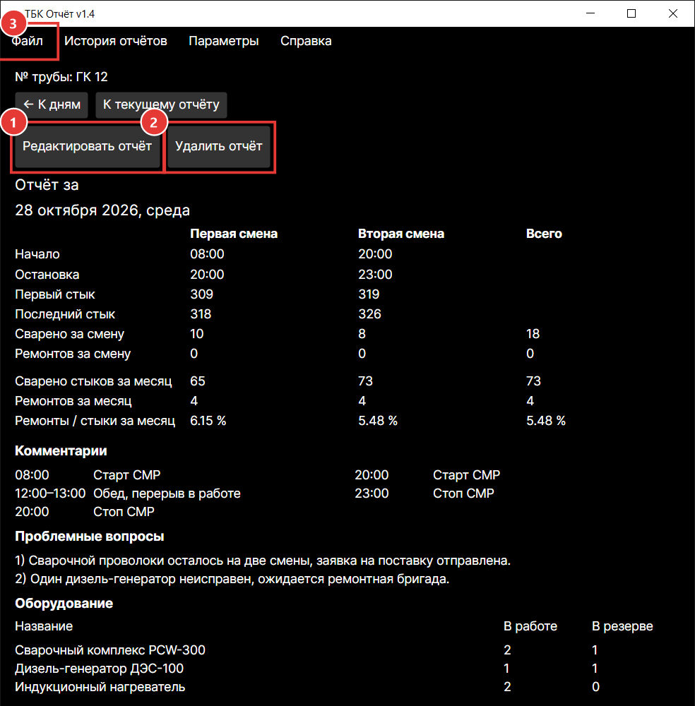

Если после запуска поля смен пустые, это не означает, что сохранённый отчёт пропал. После успешного сохранения черновик очищается; для просмотра или исправления готового отчёта откройте историю.

## 10. Настройки
Откройте меню «Параметры». После изменения настроек нажмите «Сохранить».

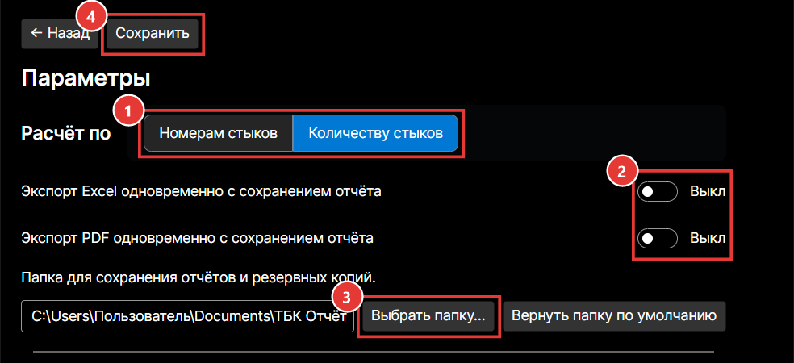

### Выберите удобный способ ввода стыков
- «Номерам стыков»: вы указываете первый и последний номера, программа считает количество.
- «Количеству стыков»: вы указываете количество в поле «Сварено за смену», программа определяет первый и последний номера.

После установки по умолчанию выбран режим «Количеству стыков». Выбранный режим запоминается.

В обоих режимах учитываются история и начальные данные выбранного ГК. Например, при первом номере 101 и количестве 10 последним будет 110. Количество сваренных стыков должно быть положительным целым числом.

### Включите автоматический экспорт
Переключатели «Экспорт Excel одновременно с сохранением отчёта» и «Экспорт PDF одновременно с сохранением отчёта» работают независимо: можно выбрать один формат или оба.

После успешного сохранения отчёта нужные файлы создаются автоматически. Существующие файлы за ту же дату обновляются. Если экспорт завершился ошибкой, запись уже сохранена в истории: проверьте сообщение программы и повторите выгрузку вручную.

### Выберите папку для готовых файлов
Нажмите «Выбрать папку…», укажите удобное место для отчётов и сохраните настройки. В эту папку будут попадать Excel, PDF и резервные копии.

---

## 11. Резервные копии и передача данных другому технику
Если коллеге нужно продолжить ведение отчётов с вашей историей и подготовленными данными, используйте перенос данных.

В «Параметрах» отметьте, что включить в резервную копию: историю, проблемы, оборудование, начальные данные, настройки, шапку, техников и подписи. Например, для продолжения работ на другом устройстве можно выбрать все разделы.

Нажмите «Экспорт данных». Программа создаст файл «TBK Backup.tbkdata» в выбранной папке экспорта. Передайте его коллеге. Повторный экспорт заменяет копию с тем же именем; чтобы сохранить предыдущую, заранее переименуйте её или перенесите.

На другом устройстве откройте «Параметры» → «Импорт данных», выберите полученный файл, прочитайте сообщение и подтвердите импорт.

При переносе важно учитывать:
- Отчёты с совпадающими датами заменяются записями из копии. Другие даты остаются.
- Начальные данные из копии заменяют соответствующие значения для совпадающих месяца и ГК.
- Переносятся только включённые в копию разделы. Техники и подписи выбираются отдельно от шапки.
- Незавершённый черновик и выбранная папка экспорта не переносятся.

После импорта перезапустите программу, чтобы загрузить переданные данные по умолчанию. Перед началом работы проверьте шапку, номер ГК, оборудование, проблемы и историю — так же, как при приёме смены на трассе.

---

## 12. Чем отличается интерфейс Windows и Android
Порядок подготовки отчёта на смартфоне остаётся тем же: шапка, оборудование, проблемы, начальные данные и заполнение смен. Описанные выше шаги показаны для Windows; на Android нужные разделы и команды расположены следующим образом.

### Переход между разделами
В Windows смены открываются вкладками «Первая смена» и «Вторая смена». Шапка, оборудование, проблемы и начальные данные находятся внутри вкладки «Данные отчёта».

На Android нажмите кнопку с тремя горизонтальными полосками в левом верхнем углу. В боковом меню выберите смену или раскройте «Данные отчёта» и выберите нужный раздел. Название открытого раздела показано вверху экрана. Между разделами также можно переходить горизонтальным движением пальца — смахиванием влево или вправо.

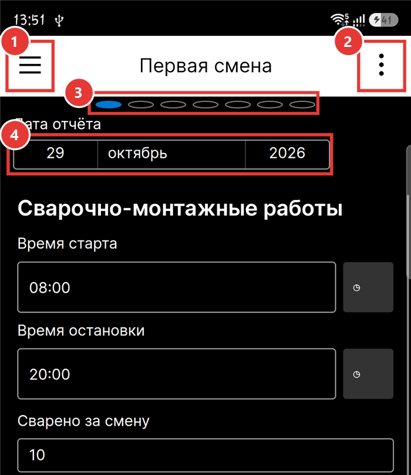

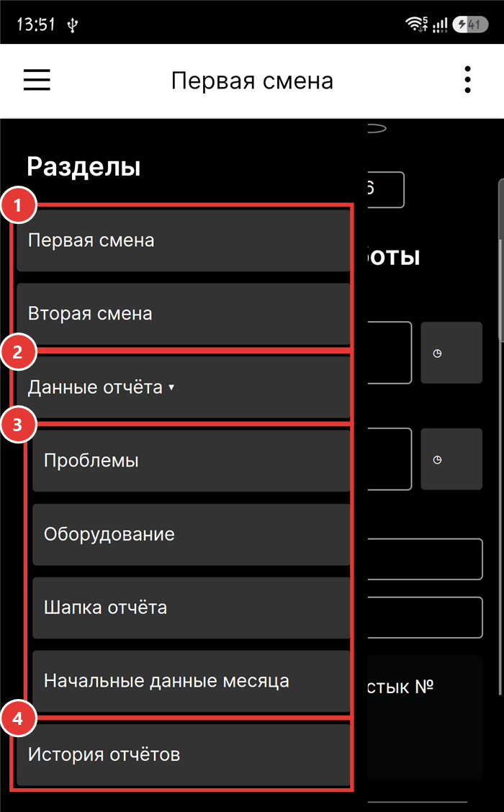

### Дата, сохранение и экспорт
В Windows дата, кнопки «Сохранить» и «Новый отчёт» находятся над вкладками, а экспорт доступен отдельными кнопками и через меню «Файл».

На Android дата находится над прокручиваемой формой отчёта. Для основных действий нажмите три точки в правом верхнем углу. Здесь расположены «Сохранить отчёт», «Экспортировать Excel», «Экспортировать PDF» и «Новый отчёт».

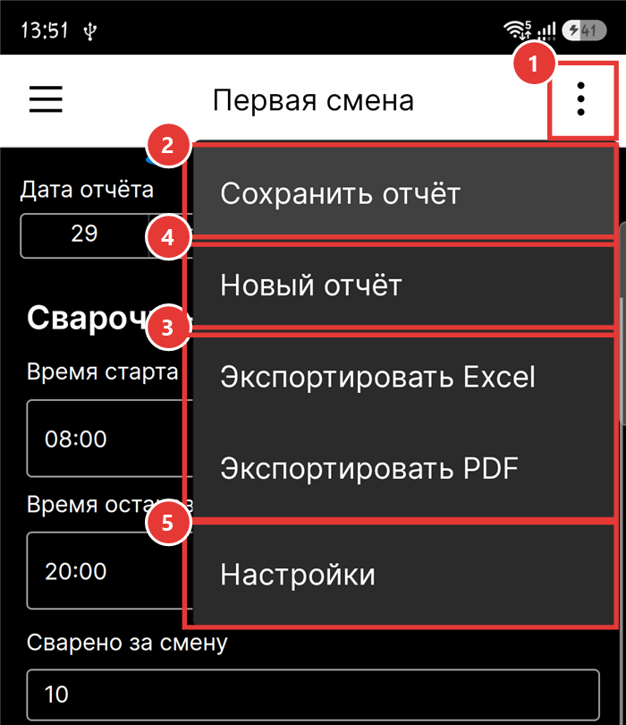

Кнопки «Сохранить данные» и «Сохранить начальные данные» на Android находятся над формой соответствующего раздела. Сохраняйте ими подготовленные сведения так же, как в Windows.

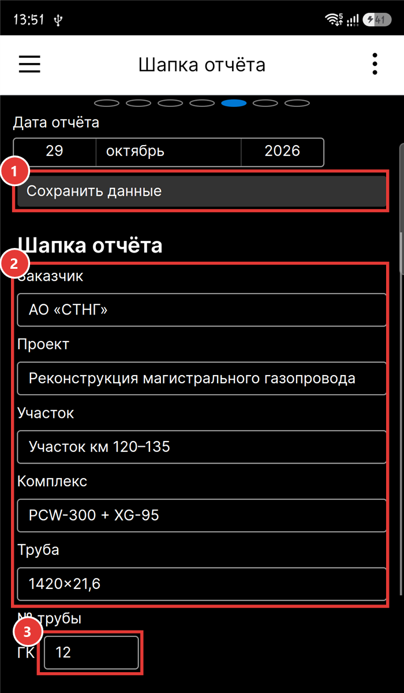

### Заполнение полей и подпись
В Windows поля рассчитаны на работу мышью и клавиатурой; например, техники обеих смен показаны рядом. На Android поля шапки расположены друг под другом: прокручивайте экран вниз, чтобы заполнить всё. Текст вводится с экранной клавиатуры.

В Windows подпись рисуется прямо в шапке мышью или с удержанием Shift при работе с тачпадом. На Android редактор подписи открывается поверх формы, а рисовать нужно пальцем. В нём доступны «Очистить», «Сохранить» и «Отмена».

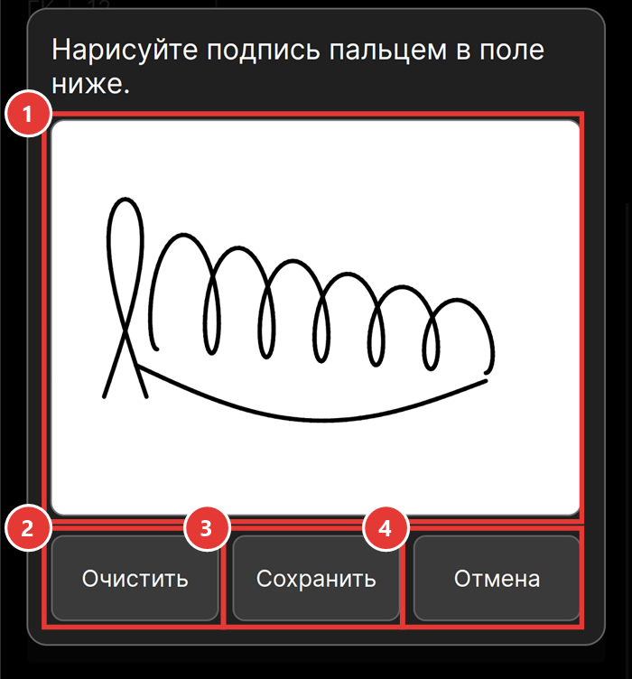

### История и возврат назад
В Windows история открывается пунктом «История отчётов» в верхнем меню. На Android этот пункт находится в левом боковом меню. Выбор одинаковый: месяц и год → день → отчёт.

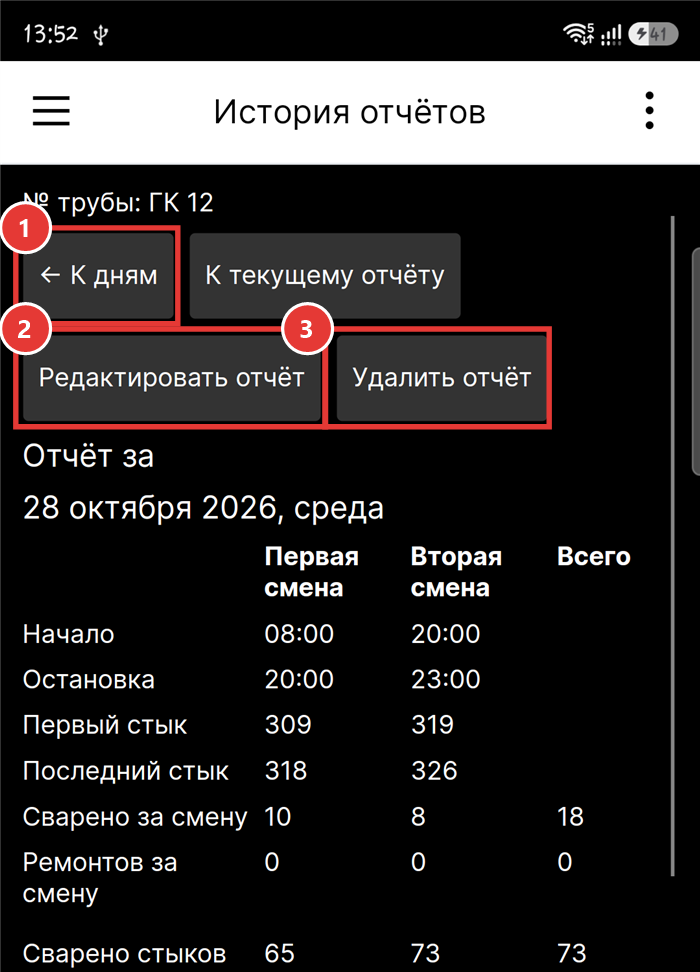

На смартфоне можно пользоваться как кнопками возврата на экране, так и системной кнопкой или жестом «Назад». В истории возврат идёт от отчёта к дням, затем к месяцам. Если открыт редактор подписи, системное действие «Назад» отменяет её редактирование.

При исправлении сохранённого отчёта в Windows нажмите «Отмена» рядом с датой. На Android доступны кнопка «Отмена» под уведомлением о редактировании и пункт «Отменить редактирование» в меню с тремя точками.

### Настройки и выбор папки
В Windows настройки открываются через верхнее меню «Параметры». На Android нажмите три точки справа вверху и выберите «Настройки».

В Windows путь к папке экспорта можно ввести вручную или выбрать кнопкой «Выбрать папку…». На Android эта кнопка открывает системное окно выбора папки: выберите её и подтвердите доступ. На смартфоне также есть кнопка «Вернуть папку по умолчанию». Кнопка «Сохранить» расположена ниже выбора папки; при необходимости прокрутите экран.

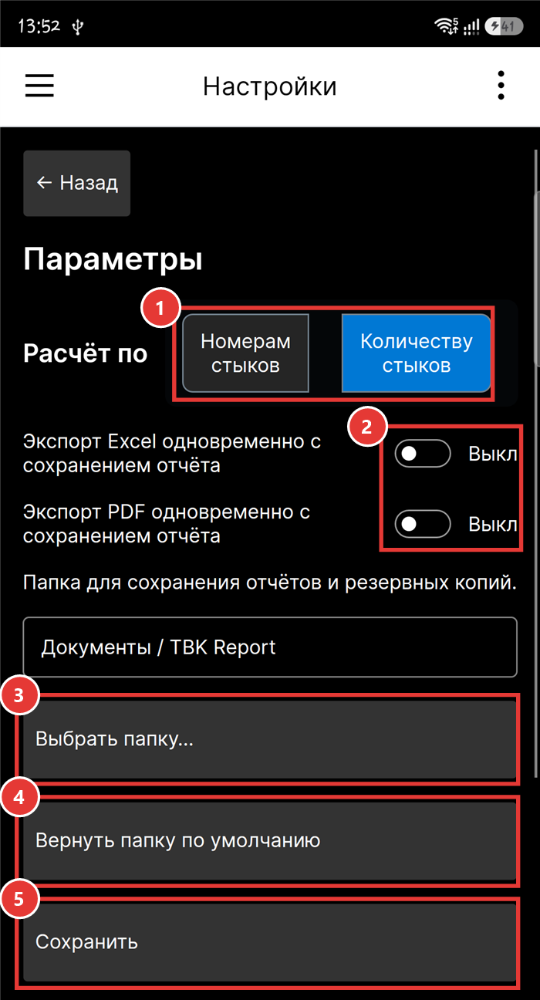

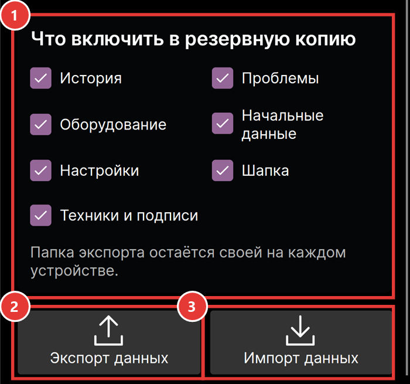
